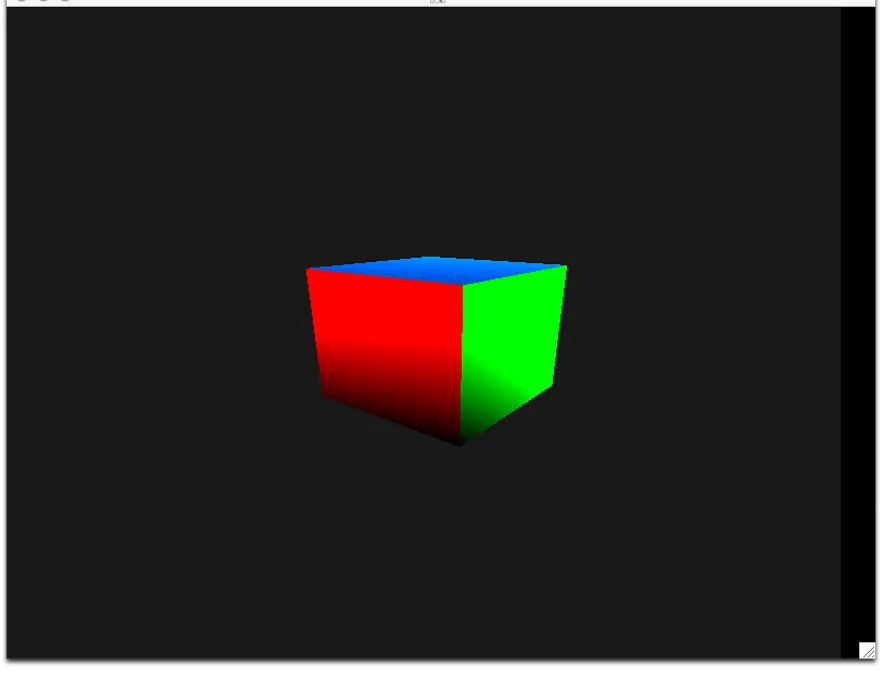
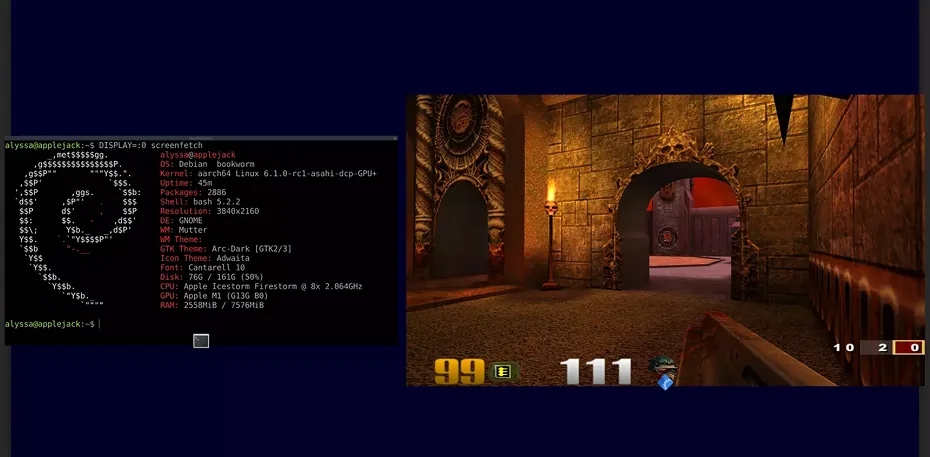
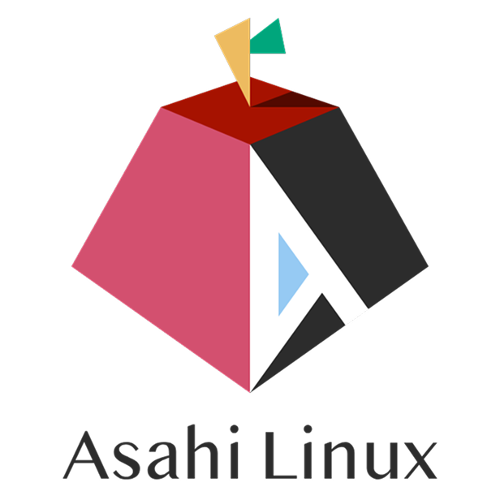

وقتی اپل در سال ۲۰۲۰ نخستین مک‌های مجهز به تراشهٔ M1 را عرضه کرد، از <Tooltip tip="Central Processing Unit؛ واحد پردازش مرکزی">CPU</Tooltip> و <Tooltip tip="Neural Processing Unit؛ واحد پردازش عصبی">NPU</Tooltip> گرفته تا <Tooltip tip="Graphics Processing Unit؛ واحد پردازش گرافیکی">GPU</Tooltip> آن، طراحی اختصاصی اپل بود. برای این GPU، مستندات فنی عمومی و درایور متن‌بازی وجود نداشت. بنابراین، هر کسی که می‌خواست محیط دسکتاپ و برنامه‌های سه‌بعدی در سیستم‌عامل‌هایی به‌جز macOS روی این مک‌ها اجرا کند، باید به پردازش نرم‌افزاری در CPU متکی می‌ماند، یا برای فهمیدن سازوکار این سخت‌افزار و ساختن <Tooltip tip="Graphics Stack">استک گرافیکی</Tooltip> از صفر، تلاش می‌کرد. این مقاله، روایت همین فرایند است که در پروژهٔ Asahi Linux انجام شد.

## آغاز کار آلیسا روزنتسوایگ

پروژهٔ Asahi Linux در دسامبر ۲۰۲۰ به ابتکار هکتور مارتین آغاز شد. هدف آن، اجرای مستقیم لینوکس روی مک‌های مبتنی بر تراشه‌های اپل بود. آلیسا روزنتسوایگ، دانشجوی علوم کامپیوتر از دانشگاه تورنتو، که روی Panfrost (درایور آزاد پردازنده‌های گرافیکی Mali) کار کرده بود، یکی از افرادی بود که به درخواست مارتین از توسعه‌دهندگان پروژه‌های متن‌باز برای همکاری، پاسخ داد. روزنتسوایگ ابتدا قصد داشت فقط چند توصیهٔ کوتاه بدهد، اما یک Mac mini خرید و خودش کار را در <Tooltip tip="User Space">فضای کاربر</Tooltip> به دست گرفت.

اما چگونه این کار را در لینوکس، بدون وابستگی به درایور هسته انجام داد؟ پاسخ این است که به‌جای وابستگی به <Tooltip tip="Linux Kernel">هستهٔ لینوکس</Tooltip>، کار در فضای کاربر را داخل macOS و با مهندسی معکوس درایور گرافیکی اپل انجام می‌داد. در روش او، کتابخانه‌ای کوچک به یک برنامهٔ آزمایشی تزریق می‌شود و فراخوانی‌های میان برنامه و هسته را رهگیری می‌کند. هنگام ارسال دستورها به GPU، این کتابخانه محتوای حافظهٔ مشترک را برای تحلیل ذخیره می‌کند. در macOS به‌جای `LD_PRELOAD`، باید از `DYLD_INSERT_LIBRARIES` و به جای `ioctl`، از چارچوب IOKit استفاده می‌کرد. فراخوانی مهم `IOConnectCallMethod` مسیر ارتباط برنامه‌های گرافیکی با درایور هسته بود. با دنبال کردن تخصیص حافظه، ایجاد بافر دستور و ارسال، می‌توانست محتوای حافظه را ثبت و سپس جداگانه بررسی کند. البته یافتن این فراخوانی‌ها نیز به‌دلیل نبود مستندات، ساده نبود.

نخستین هدف، شناخت مجموعه‌دستورهای Shader بود، یعنی کدی که روی GPU اجرا می‌شود. روزنتسوایگ Shader‌های بسیار ساده‌ای را با ابزار رسمی اپل کامپایل می‌کرد، تغییر کوچکی در کد می‌داد و خروجی دودویی دو نسخه را مقایسه می‌کرد. با تکرار این کار، بخش‌هایی از قالب دستورها، عملگرها و رجیسترها آشکار شد. او در ژانویهٔ ۲۰۲۱، ابزاری متن‌باز برای Disassemble کردن Shader‌های ساده منتشر کرد که کد دودویی اجرایی را به صورت تقریبی، به دستورات اسمبلی برمی‌گرداند تا مهندسی معکوس تسهیل شود. این عمل، با Decompile کردن که تبدیل کد دودویی به زبان سطح بالاست، تفاوت دارد.

## رسم نخستین مثلث

در گرافیک سه‌بعدی، رسم نخستین مثلث نقطهٔ عطفی است، زیرا هر صحنه‌ای در نهایت از مثلث‌ها ساخته می‌شود. کمتر از یک ماه پس از شروع کار، نخستین مثلث با کد روزنتسوایگ روی M1 رسم شد، هرچند Shader رأس و Shader قطعه هنوز به زبان ماشین نوشته شده بودند.

او برای رسیدن به این نتیجه، گام‌به‌گام پیش رفت. نخست، رنگ پس‌زمینه را در بافرهایی که Metal (رابط گرافیکی اپل) ساخته بود تغییر داد. بعد، Shader‌ها را با نسخه‌های دست‌نویس جایگزین کرد. پس از آن، ساختارها را از نو ساخت تا هر خطا قابل‌ردیابی باشد.

در این مسیر به مشکلی عجیب برخورد: حافظه‌ای که خودش با پارامترهای Metal تخصیص می‌داد، کار نمی‌کرد. سرانجام، معلوم شد جدولی در حافظهٔ GPU، فهرست تخصیص‌های مجاز را نگه می‌دارد و آخرین خانهٔ این جدول همیشه صفر است. رنگ موردنظر فقط زمانی ظاهر شد که شناسهٔ حافظهٔ جدید پیش از این خانهٔ پایانی قرار گرفت.

## از زبان ماشین تا Mesa و باگ ناممکن

رسم مثلث فقط اثبات امکان‌پذیری روش بود. یک درایور واقعی، به کامپایلری نیاز داشت که زبان‌هایی مانند <Tooltip tip="OpenGL Shading Language">GLSL</Tooltip> را به دستورهای بومی GPU تبدیل کند. در ماه‌های بعد، روزنتسوایگ نوشتن چنین کامپایلری را برای Mesa (مجموعهٔ نرم‌افزاری گرافیک لینوکس) در macOS آغاز کرد و پس از یک هفته توانست با آن، Shader‌های پایهٔ رأس و قطعه را تولید کرده و یک مکعب سه‌بعدی سایه‌زده را رندر کند. تا مه ۲۰۲۱، درایور حدود ۷۵ درصد آزمون‌های OpenGL ES 2 را پشت سر می‌گذاشت و کد کامپایلر و درایور نیز به Mesa راه یافته بود.

یکی از خواندنی‌ترین بخش‌های این ماجرا مشکلی است که روزنتسوایگ آن را «باگ ناممکن» نامید. درایور، مدل‌های ساده را درست رسم می‌کرد، اما در مدل‌های پرجزئیات فقط بخشی از تصویر را می‌کشید و خطا می‌داد. پاسخ در معماری GPU یافت شد. با توجه به این‌که M1 یک طراحی بزرگ‌تر مبتنی‌بر تراشهٔ A14 است (Apple Family 7) که ریشه در گوشی‌های آیفون دارد، معماری گرافیکی آن «<Tooltip tip="Tile-based Rendering">کاشی‌محور</Tooltip>» است. شایعات بر این بودند که طراحی‌های پیشین GPU‌های موبایلی اپل -از Apple Family 4 یا تراشهٔ A11 به بعد- همین معماری را با الهام از PowerVR از شرکت Imagination داشتند، برخلاف معماری‌های متداول دسکتاپی که <Tooltip tip="Immediate-mode Rendering">حالت فوری</Tooltip> هستند. با در نظر گرفتن تشابه احتمالی با معماری PowerVR، چنین پردازنده‌ای با استفاده از مفهوم «Tiled Vertex Buffer» (یا Parameter Buffer در PowerVR) ابتدا داده‌های همهٔ رأس‌ها را در بافری در حافظه ذخیره می‌کند و سپس تصویر را کاشی به کاشی می‌سازد. پس از پر شدن این بافر، رندر جزئی انجام می‌شود. درایور متن‌باز، کد لازم برای ادامهٔ کار پس از رندر جزئی را فراهم نکرده بود. با افزودن آن و تنظیم درست بافر عمق، مشکل حل شد.

## درایور هسته و میان‌افزار

بخش بزرگی از کار اولیه در فضای کاربر و حتی روی macOS انجام شده بود و برای لینوکس، هنوز درایور هسته نیاز بود. «Asahi Lina» در سال ۲۰۲۲ این بخش را بر عهده گرفت و با <Tooltip tip="Hypervisor">ابرناظر</Tooltip> m1n1 ارتباط macOS با GPU را در سطحی پایین‌تر رهگیری کرد. او دریافت که GPU اپل، یک پردازندهٔ کمکی از نوع ARM64 دارد که سیستم‌عامل بی‌درنگ یا <Tooltip tip="Real-time Operating System؛ سیستم‌عامل بی‌درنگ">RTOS</Tooltip> اختصاصی اپل را اجرا می‌کند. تمام وظایف مدیریت GPU از جمله زمان‌بندی کارها، مدیریت توان و بازیابی از خطا بر عهدهٔ <Tooltip tip="Firmware">ثابت‌افزار</Tooltip> این پردازندهٔ کمکی است، بدون دخالت هستهٔ macOS! بنابراین، نوشتن درایور هسته، مستلزم بازسازی پروتکلی بین هسته، میان‌افزار و واحدهای گرافیکی بود. لینا این درایور را به Rust نوشت؛ زبانی که در حال ورود رسمی به هستهٔ لینوکس بود و این درایور را به نخستین درایور گرافیکی به زبان Rust بدل می‌کرد. سرانجام، درایور هسته در کنار درایور فضای کاربر و کامپایلر روزنتسوایگ، سه بخش اصلی استک گرافیکی Asahi را تشکیل داد.

## انتشار عمومی و پایان کار

تا اوت ۲۰۲۲، درایور Asahi علاوه‌بر رسم مثلث و مکعب، بازی‌های واقعی روی M1 اجرا می‌کرد.

در دسامبر همان سال، نخستین نسخهٔ عمومی درایور GPU برای Asahi Linux منتشر شد، که OpenGL 2.1 و OpenGL ES 2.0 را در حد اجرای محیط‌های دسکتاپ KDE،GNOME و بازی‌هایی مانند Quake III و Neverball روی GPU پشتیبانی می‌کرد.

از سال ۲۰۲۳ به بعد، پس از پایان تحصیل روزنتسوایگ، تلاش‌ها برای سازگاری درایور Asahi با OpenGL 4.6 و OpenGL ES 3.2 شروع شد، درحالی‌که macOS سال‌ها فقط از OpenGL 4.1 پشتیبانی کرده بود. برخی قابلیت‌هایی که M1 پشتیبانی سخت‌افزاری مستقیم برای آن‌ها نداشت، با کمک Compute Shader‌ها پیاده‌سازی شدند. پس از آن، درایور Vulkan 1.3 به نام Honeykrisp نوشته شد. سپس، ترکیب Vulkan با DXVK، نرم‌افزار Proton و شبیه‌سازی x86، راه اجرای بازی‌های ویندوزی را هموار کرد. روزنتسوایگ در جمع‌بندی سال ۲۰۲۵ نوشت که

با سازگاری استک Asahi با OpenGL 4.6 OpenCL 3.0،OpenGL ES 3.2 و Vulkan 1.3 و upstream شدن درایورها به Mesa، به اهدافش رسیده است. او با پیوستن به شرکت اینتل، از سازوکار اپل کناره گرفت و ادامهٔ کار را به دیگر اعضای Asahi سپرد.

ماجرای GPU در Asahi Linux نمونه‌ای کم‌نظیر از مهندسی معکوس سخت‌افزار مدرن است.

گروه پروژه، نه به مستندات داخلی اپل دسترسی داشت و نه می‌توانست از کد درایور رسمی استفاده کند. پیشرفت با مشاهده، مقایسه، آزمایش و ساخت فرضیه انجام شد: از تغییر یک رنگ در بافر فرمان و نوشتن Shader با زبان ماشین تا شناخت میان‌افزار و اجرای بازی‌های مدرن، همگی با اتکا بر اکوسیستم متن‌باز لینوکس و Mesa.
