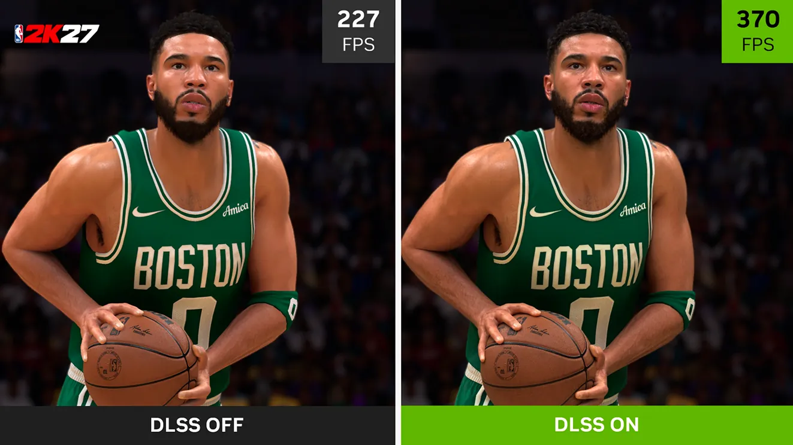
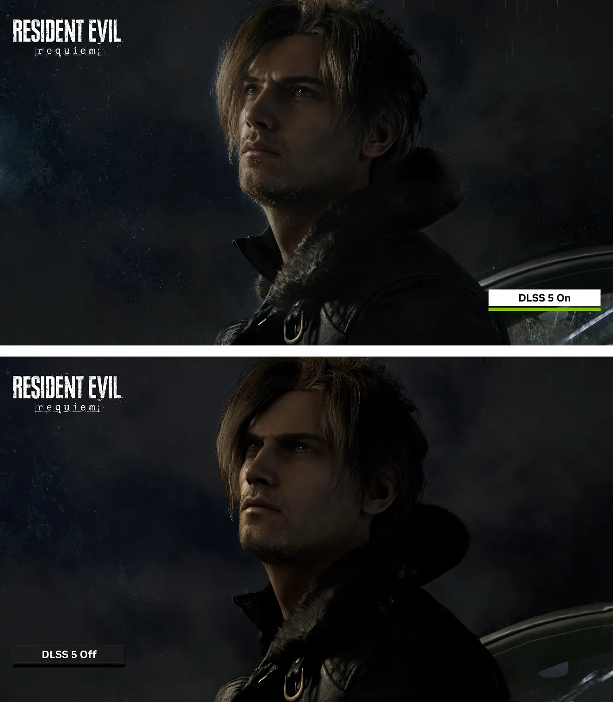
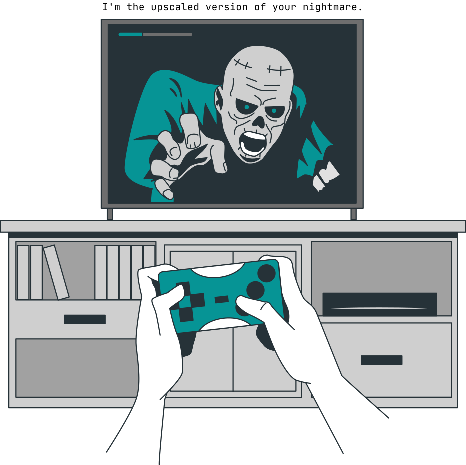

در سال‌های نه‌چندان دور، ایجاد جلوه‌های بصری چشم‌گیر در بازی‌های ویدیویی بیش از هر چیز به یک عامل وابسته بود: قدرت خام پردازشی کارت‌های گرافیک. برای سال‌ها، مسیر پیشرفت صنعت بر افزایش تعداد ترانزیستورها، بزرگ‌تر شدن معماری‌های پردازشی و تولید سخت‌افزارهای قدرتمندتر استوار بود. این رویکرد تا زمانی که محدودیت‌های فیزیکی و اقتصادی اجازه می‌داد، پاسخ‌گوی نیازهای روزافزون بازی‌ها بود؛ اما پرسش اساسی این بود که تا چه زمانی می‌توان این مسیر را ادامه داد؟ با پیچیده‌تر شدن محیط‌های بازی، افزایش رزولوشن‌ها و ورود فناوری‌هایی مانند <Tooltip tip="Ray Tracing">رهگیری پرتو</Tooltip>، دیگر فقط افزایش قدرت سخت‌افزاری نمی‌توانست راه‌حل تمام چالش‌ها باشد. همین محدودیت‌ها زمینه را برای ظهور روش‌های جدیدی فراهم کردند که به‌جای تکیۀ صرف بر قدرت پردازشی، از هوش مصنوعی برای دستیابی به کیفیت بصری بالاتر استفاده می‌کنند.

در همین راستا، شرکت NVIDIA در سال ۲۰۱۸ فناوری جدیدی با نام <Tooltip tip="Deep Learning Super Sampling">DLSS</Tooltip> معرفی کرد. DLSS راهکاری مبتنی‌بر هوش مصنوعی است که برای افزایش کیفیت تصویر و بهبود عملکرد بازی‌های ویدیویی توسعه داده شده ‌است. ایدۀ اصلی این فناوری بر یک تغییر رویکرد اساسی استوار است؛ به‌جای این‌که کارت گرافیک تمام تصویر را با بالاترین رزولوشن ممکن تولید کند، بازی می‌تواند تصویر را در رزولوشنی پایین‌تر رندر کند و سپس با کمک مدل‌های یادگیری عمیق، نسخه‌ای با جزئیات بیش‌تر و کیفیت بالاتر از آن بازسازی شود. این روش باعث می‌شود فشار پردازشی روی GPU کاهش پیدا کند و منابع آزاد‌شده برای بخش‌های سنگین‌تر -مانند رهگیری پرتو یا جلوه‌های بصری پیشرفته- مورد استفاده قرار گیرند.

در پشت این فرایند، یک شبکۀ عصبی قرار دارد که با استفاده از حجم عظیمی از تصاویر با کیفیت بالا آموزش دیده است تا بتواند جزئیات از دست‌رفته در تصاویر کم‌رزولوشن را پیش‌بینی و بازسازی کند. بر‌خلاف روش‌های سنتی افزایش رزولوشن که تنها بر بزرگ‌تر کردن تصویر و تخمین سادۀ پیکسل‌ها تکیه دارند، DLSS از اطلاعات بیش‌تری مانند فریم‌های قبلی و نحوۀ حرکت اجسام در صحنه استفاده می‌کند تا تصویری پایدارتر و نزدیک‌تر به خروجی رندر اصلی تولید کند. به همین دلیل، DLSS تنها یک ابزار افزایش رزولوشن نیست، بلکه نمونه‌ای از حرکت صنعت بازی به سمت استفاده از هوش مصنوعی برای بازسازی و تولید محتوای گرافیکی در زمان واقعی است.

## تاریخچۀ DLSS و نسخه‌های آن

همان‌طور که اشاره شد، اولین نسخۀ DLSS در سال ۲۰۱۸ معرفی شد. ایدۀ اولیۀ این فناوری ساده بود: به‌جای رندر مستقیم بازی در رزولوشن بالا، تصویر در رزولوشنی پایین‌تر تولید می‌شود و سپس یک شبکۀ عصبی آموزش‌دیده، جزئیات از دست‌رفته را بازسازی می‌کند. با وجود ایدۀ نوآورانه، DLSS 1 نتوانست انتظارات را به‌طور کامل برآورده کند. مدل هوش مصنوعی این نسل برای هر بازی به‌صورت جداگانه آموزش می‌دید و در بسیاری از موارد خروجی نهایی با مشکلاتی مانند تاری تصویر و ایجاد ناهماهنگی‌های بصری همراه بود؛ به گونه‌ای که در برخی شرایط، تصویر رندر‌شده در رزولوشن اصلی کیفیت بهتری ارائه می‌داد.

با معرفی DLSS 2 در سال ۲۰۲۰، این فناوری وارد مرحله‌ای جدید شد. NVIDIA در این نسخه رویکرد آموزش مدل را تغییر داد و به‌جای استفاده از مدل‌های اختصاصی برای هر بازی، از یک مدل عمومی‌تر استفاده کرد که می‌توانست در بازی‌های مختلف عملکرد بهتری داشته باشد. همچنین، DLSS 2 با استفاده از اطلاعات زمانی، یعنی داده‌های مربوط به فریم‌های قبلی، توانست تصمیم‌های دقیق‌تری برای بازسازی تصویر بگیرد. این تغییر باعث افزایش چشمگیر کیفیت تصویر شد و DLSS را به یکی از فناوری‌های مهم در بهینه‌سازی گرافیک بازی‌ها تبدیل کرد. این فرایند با استفاده از هسته‌های Tensor -سخت‌افزارهایی اختصاصی برای انجام محاسبات هوش مصنوعی- انجام می‌شد.

در سال ۲۰۲۲، DLSS 3 با معرفی قابلیت Frame Generation گام متفاوتی برداشت. در نسخه‌های قبلی، هوش مصنوعی وظیفۀ بازسازی یک تصویر با رزولوشن بالاتر را بر عهده داشت، اما در DLSS 3 سیستم قادر شد فریم‌های کاملاً جدیدی بین فریم‌های واقعی تولید کند.

این کار با کمک اطلاعاتی مانند بردارهای حرکت و داده‌های مربوط به تغییرات صحنه انجام می‌شد و می‌توانست نرخ فریم قابل‌مشاهده را به میزان قابل‌توجهی افزایش دهد. البته این روش در کنار روان‌تر کردن تصاویر، محدودیت‌هایی مانند افزایش تأخیر ورودی داشت و به سخت‌افزارهای جدیدتر سری RTX 40 نیاز داشت.

DLSS 4 که همراه با معرفی معماری Blackwell و کارت‌های RTX 50 در سال ۲۰۲۵ معرفی شد، دو تغییر مهم را به‌همراه داشت. نخستین قابلیت، Multi Frame Generation بود که امکان تولید چندین فریم مصنوعی میان فریم‌های رندر‌شده را فراهم کرد.

دومین تغییر، جایگزینی معماری سنتی‌تر شبکه‌های عصبی کانولوشنی با معماری Transformer بود؛ معماری‌ای که در سال‌های اخیر در بسیاری از مدل‌های پیشرفتۀ هوش مصنوعی مورد استفاده قرار گرفته است. این تغییر به مدل اجازه می‌دهد ارتباطات پیچیده‌تر میان بخش‌های مختلف تصویر و تغییرات زمانی صحنه را بهتر درک کند و در نتیجه، پایداری و کیفیت بازسازی تصویر بهبود پیدا کند.

با وجود پیشرفت‌های هر نسل، DLSS تا این مرحله بر دو هدف اصلی تمرکز داشت: بازسازی تصویر با کیفیت بالاتر و افزایش نرخ فریم. اما DLSS 5 رویکرد متفاوتی را دنبال کرد؛ رویکردی که بیش‌تر به سمت استفاده از هوش مصنوعی برای درک و بازسازی هوشمندانه‌تر صحنه‌های گرافیکی حرکت می‌کند.

## گام بعدی، DLSS 5

در مارس ۲۰۲۶، NVIDIA از نسل جدید فناوری DLSS با نام DLSS 5 رونمایی کرد؛ نسلی که بر‌خلاف تمرکز عمدۀ نسخه‌های قبلی بر بازسازی تصویر و افزایش نرخ فریم، قدم دیگری به سمت استفادۀ مستقیم از هوش مصنوعی در فرایند تولید گرافیک برداشت. DLSS 5 با معرفی فناوری 3D-Guided Neural Rendering، از مدل‌های هوش مصنوعی برای ایجاد نورپردازی و موارد واقع‌گرایانه‌تر در صحنه‌های بازی استفاده می‌کند. این فناوری از سپتامبر ۲۰۲۶ به‌صورت رسمی در دسترس قرار گرفت و نخستین بار با بازی NBA 2K27 برای کارت‌های گرافیک سری GeForce RTX 50 ارائه شد.

DLSS 5 را نمی‌توان صرفاً نسخه‌ای سریع‌تر یا دقیق‌تر از فناوری‌های قبلی DLSS دانست. مهم‌ترین تغییر در این نسل، حرکت از «کمک گرفتن از هوش مصنوعی پس از رندر» به «استفادۀ مستقیم از هوش مصنوعی در فرایند رندر» است؛ رویکردی که NVIDIA از آن با عنوان Neural Rendering یاد می‌کند. در نسل‌های پیشین، GPU ابتدا صحنه را با روش‌های مرسوم گرافیکی -مانند Rasterization، نورپردازی و Shading- پردازش می‌کرد و پس از تولید تصویر، مدل هوش مصنوعی وارد عمل می‌شد تا آن را بازسازی یا بهبود دهد. در DLSS 5، شبکه‌های عصبی به بخش‌هایی از خود فرایند رندر وارد می‌شوند و می‌توانند وظایفی را بر عهده بگیرند که پیش از این به‌صورت کامل با روش‌های سنتی گرافیکی انجام می‌شدند.

این تغییر را می‌توان در قالب مفهوم Neural Rendering بهتر درک کرد. در این رویکرد، هوش مصنوعی دیگر صرفاً وظیفۀ اصلاح تصویر نهایی را ندارد، بلکه می‌تواند در تولید ظاهر و رفتار بخش‌هایی از صحنه نیز مشارکت کند. برای مثال، فناوری RTX Neural Shaders امکان اجرای مدل‌های عصبی را درون Shader‌ها فراهم می‌کند و در نتیجه، محاسبات هوش مصنوعی می‌توانند در کنار محاسبات گرافیکی سنتی و با استفاده از هسته‌های Tensor انجام شوند. در کنار آن، Neural Materials می‌توانند نحوۀ نمایش موادی مانند فلز، بتن یا پوست و تعامل آن‌ها با نور را به شکل هوشمندانه‌تری مدل کنند. در حوزۀ نورپردازی نیز، شبکه‌های عصبی می‌توانند با استفاده از تعداد محدودی از مسیرهای نور، اطلاعات ناقص را بازسازی کنند و به تولید تصویری که کیفیتی نزدیک به روشی سنتی مانند Path Tracing دارد، کمک کنند. حتی فشرده‌سازی بافت‌ها نیز می‌تواند با کمک مدل ‌های عصبی انجام شود تا حجم دادۀ مورد نیاز کاهش یابد، بدون آن‌که افت کیفیت روش‌های سنتی فشرده‌سازی به همان اندازه محسوس باشد.

نخستین تلاش‌ها برای بازسازی یک تصویر کم‌رزولوشن در DLSS 1 تا ورود Neural Rendering در DLSS 5 را می‌توان بررسی کرد و دید که مرز میان «رندر کردن» و «بازسازی کردن» به‌تدریج کم‌رنگ‌تر شده است. در رویکرد جدید، بخشی از آن‌چه پیش‌تر نیازمند محاسبات سنگین و مستقیم GPU بود، به مدل‌های هوش مصنوعی سپرده می‌شود؛ تغییری که می‌تواند مسیر توسعۀ گرافیک بی‌درنگ را در سال‌های آینده تحت‌تأثیر قرار دهد.

اگر این روند ادامه پیدا کند، شاید در آینده دیگر پرسش اصلی این نباشد که GPU چقدر قدرتمند است، بلکه این باشد که GPU چقدر خوب می‌داند چه چیزی را لازم نیست خودش رندر کند و این شاید یکی از جالب‌ترین تغییراتی باشد که هوش مصنوعی تا کنون به دنیای گرافیک آورده است.

مسیر تکامل DLSS در نهایت نشان می‌دهد که نقش هوش مصنوعی در گرافیک رایانه‌ای دیگر به بهبود یک تصویر آماده محدود نمی‌شود.

