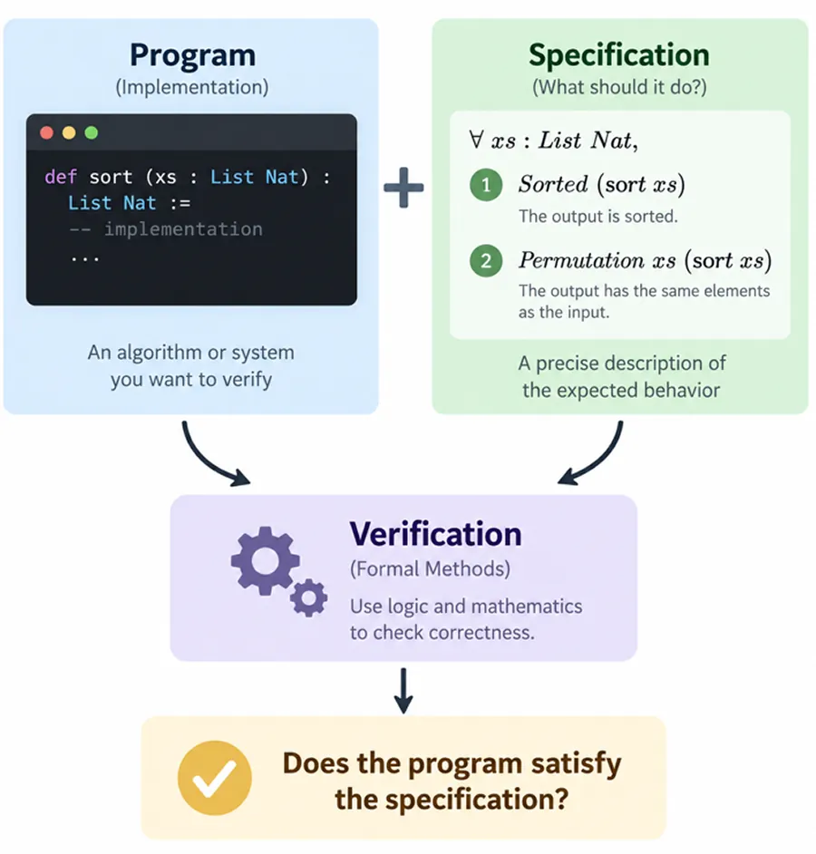
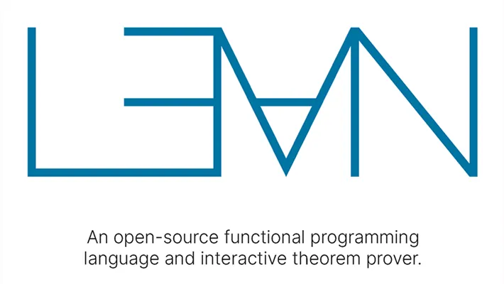
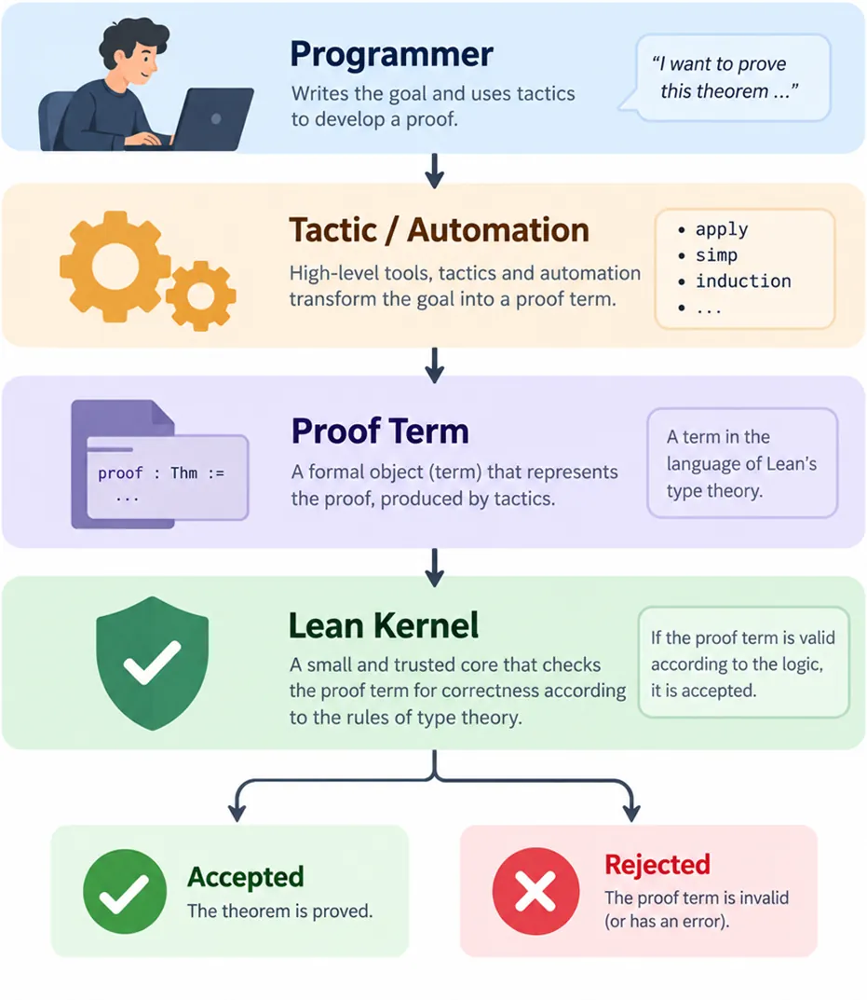
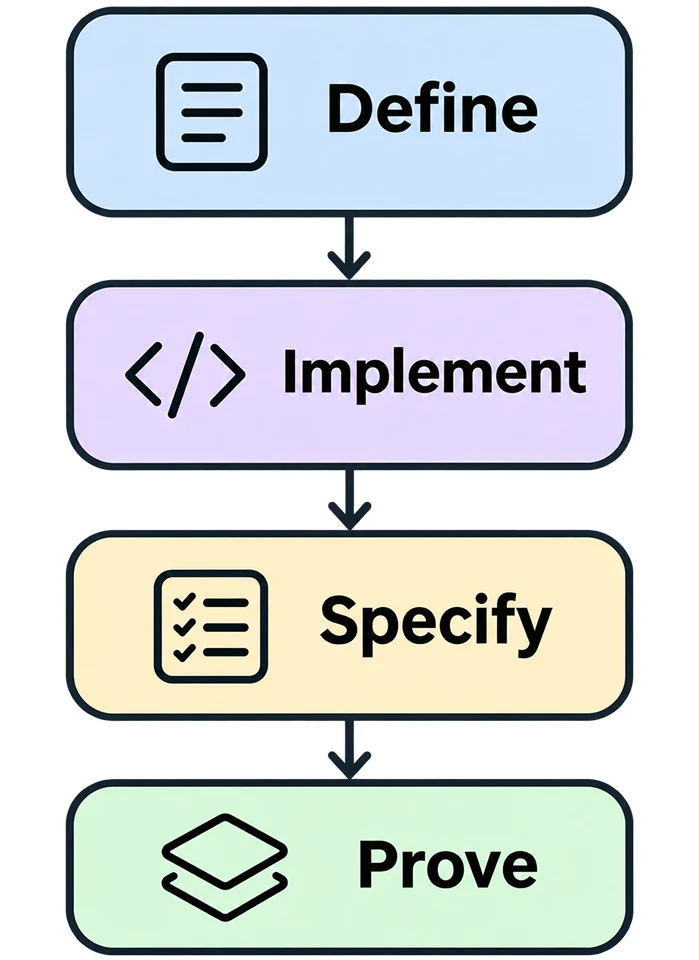
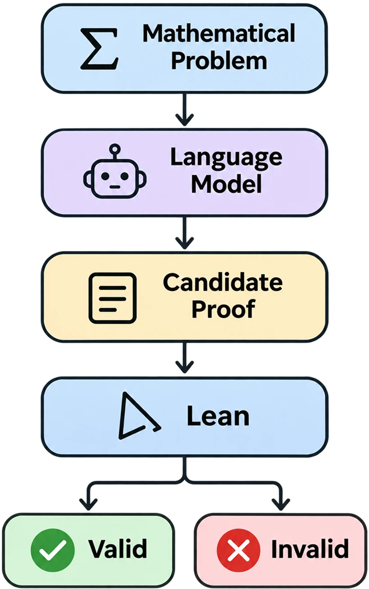
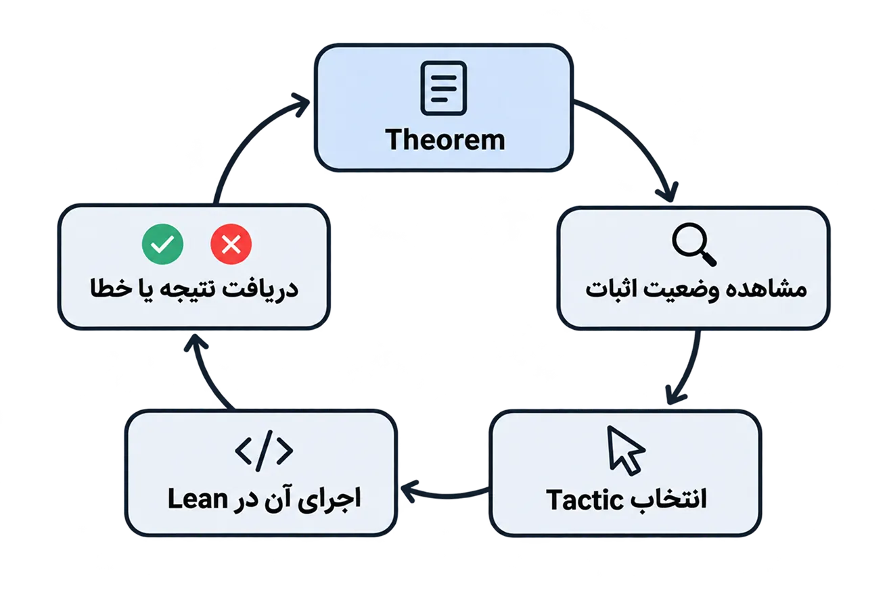
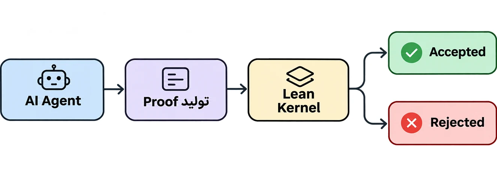
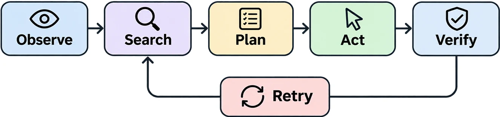
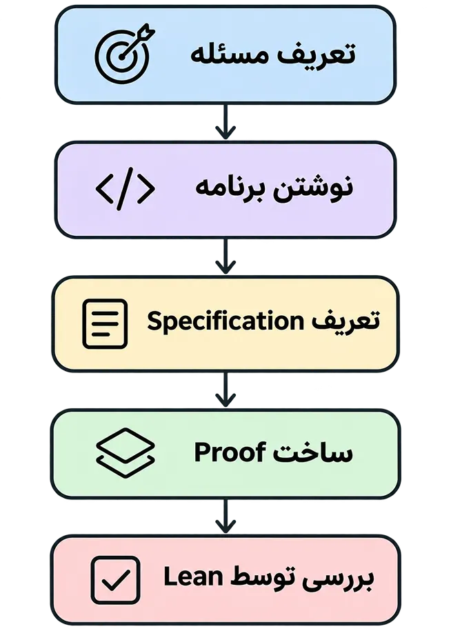

در برنامه‌نویسی، معمولاً از کامپیوتر می‌خواهیم که یک برنامه را اجرا کند و نتیجه‌ای را به‌عنوان خروجی به ما برگرداند. اما پرسش عمیق‌تری که مطرح می‌شود این است که آیا می‌توانیم علاوه‌بر اجرای یک برنامه، درستی آن را نیز بررسی کنیم؟

برای مثال، فرض کنید کد یک مسئلۀ ساده، مانند مرتب‌سازی یک آرایه را با یک الگوریتم دلخواه نوشته‌ایم. با اجرای چندین آزمون، می‌توانیم تا حدودی مطمئن شویم که برای تعدادی از ورودی‌ها، عملکرد برنامه و الگوریتم درست است. با این‌حال، حتی هزاران آزمون هم ثابت نمی‌کنند که الگوریتم برای تمامی ورودی‌های ممکن درست است.

در این‌جا مفهومی به نام روش‌های صوری یا Formal Methods مطرح می‌شود. در روش‌های صوری، هدف این است که رفتار سامانه‌های نرم‌افزاری و سخت‌افزاری با استفاده از منطق و ریاضیات به شکلی مدل شود که بتوان برخی ویژگی‌های آن‌ها را به‌صورت دقیق بررسی و در مواردی اثبات کرد.

یکی از زبان‌ها و ابزارهایی که امروزه برای چنین کاری استفاده می‌شود، Lean است.

## درستی یعنی چه؟ مفاهیم Specification و Verification

برای درک بهتر نقش Lean، ابتدا باید کمی دقیق‌تر مشخص کنیم که منظور از «درستی» یک برنامه چیست.

در مهندسی نرم‌افزار، درست بودن یک برنامه لزوماً به این معنا نیست که برنامه صرفاً بدون خطا اجرا شود. ممکن است برنامه اجرا شود، اما نتیجه‌ای تولید کند که با نیاز یا مشخصات مورد انتظار ما مطابقت نداشته باشد.

به همین دلیل، پیش از صحبت دربارۀ اثبات درستی یک برنامه، باید مشخص کنیم که از آن برنامه چه انتظاری داریم. این انتظار به‌صورت یک مشخصه یا Specification بیان می‌شود.

مشخصه توصیف می‌کند که یک سامانه یا برنامه تحت چه شرایطی باید چه رفتاری داشته باشد.

برای مثال در مسئلۀ مرتب‌سازی، تنها این‌که تابع مرتب‌سازی یک فهرست خروجی تولید کند، کافی نیست. ممکن است از آن انتظار داشته باشیم که دست‌کم دو ویژگی زیر را برآورده کند.

1. عناصر خروجی واقعاً مرتب باشند.
2. خروجی دقیقاً شامل همان عناصری باشد که در ورودی وجود داشته‌اند و هیچ عنصری حذف یا اضافه نشده باشد.

در نتیجه، چیزی که در Formal Verification اثبات می‌کنیم، معمولاً این نیست که «برنامه به‌طور کلی درست است»، بلکه اثبات می‌کنیم که برنامه با یک Specification مشخص سازگار است.

به‌طور ساده می‌توان این رابطه را به‌صورت زیر نشان داد.



فرایند بررسی این‌که آیا یک سامانه، برنامه یا الگوریتم ویژگی‌های مورد انتظار خود را برآورده می‌کند یا نه، صحت‌سنجی یا Verification نام دارد.

صحت‌سنجی می‌تواند شکل‌های مختلفی داشته باشد. در روش‌های معمول مهندسی نرم‌افزار، این بررسی ممکن است از طریق آزمون، تحلیل ایستا یا بررسی دستی کد انجام شود. اما در Formal Verification، سیستم و ویژگی‌های مورد انتظار آن با استفاده از زبان‌های دقیق منطقی و ریاضی مدل می‌شوند و سپس تلاش می‌شود درستی آن‌ها به صورت ریاضی اثبات شود.

برای مثال، فرض کنید تابعی با نام sort داریم که یک لیست را مرتب می‌کند. می‌توانیم دو ویژگی مورد انتظار برای آن تعریف کنیم:

> «برای هر فهرست xs، خروجی sort(xs) مرتب باشد.»

و همچنین:

> «برای هر لیست xs، اعضای sort(xs) همان اعضای xs باشند.»

در Formal Verification هدف این است که چنین گزاره‌هایی نه فقط برای چند ورودی آزمایشی، بلکه برای تمام ورودی‌هایی که شرایط مشخص‌شده را دارند اثبات شوند.

در همین نقطه، تفاوت مهم میان Testing و Formal Verification مشخص می‌شود. تست نشان می‌دهد که برنامه برای تعدادی ورودی مشخص رفتار درستی داشته است، در حالی که اثبات صوری می‌تواند نشان دهد یک ویژگی مشخص، تحت فرض‌های معین، برای تمام حالت‌های مورد نظر برقرار است.

البته Formal Verification به این معنا نیست که بتوان هر ویژگی دلخواهی را دربارۀ هر برنامه‌ای به‌سادگی اثبات کرد. نخست باید Specification به‌درستی نوشته شود و سپس اثبات تنها نسبت به همان Specification معنا دارد. اگر مشخصات ناقص یا اشتباه باشند، حتی یک اثبات کاملاً درست نیز لزوماً به‌معنای درست بودن سیستم از دید کاربر نخواهد بود.

اگر بخواهیم به شکل کلی‌تر تعریف کنیم، Formal Methods نام مجموعه‌ای از روش‌ها و ابزارهایی است که برای توصیف، مدل‌سازی، تحلیل و اثبات ویژگی‌های سیستم‌ها با استفاده از منطق و ریاضیات به‌کار می‌روند. Formal Verification یکی از مهم‌ترین کاربردهای این روش‌هاست.

ابزارهایی مانند Lean دقیقاً در همین چارچوب قرار می‌گیرند. Lean به ما اجازه می‌دهد ویژگی‌های مورد انتظار یک سیستم را به‌صورت گزاره‌های دقیق بیان کنیم و سپس برای آن‌ها اثبات‌هایی بسازیم که خود کامپیوتر قادر به بررسی صحت آن‌ها باشد.



## Lean چیست؟

Lean در عین حال یک زبان برنامه‌نویسی و یک <Tooltip tip="Interactive Theorem Prover"><span>اثبات‌گر تعاملی قضایا</span></Tooltip> است.

این زبان بر پایۀ نوعی از نظریۀ <Tooltip tip="Dependent Type Theory"><span>انواع وابسته</span></Tooltip> طراحی شده و می‌توان از آن، هم برای تعریف داده‌ها و نوشتن برنامه‌ها و هم برای بیان و اثبات گزاره‌های ریاضی استفاده کرد.

از این نظر، Lean در نقطه‌ای جالب میان چند حوزه قرار می‌گیرد: برنامه‌نویسی تابعی، منطق ریاضی، نظریۀ نوع‌ها و Formal Verification.

برای شروع، Lean آن‌قدرها هم با زبان‌های برنامه‌نویسی دیگر غریبه نیست. برای مثال، می‌توان تابعی تعریف کرد که یک عدد طبیعی را دو برابر کند:

```lean4
def double (n : Nat):Nat :=
  n + n
```

در این کد، Nat نوع اعداد طبیعی است. بنابراین تابع double، یک مقدار از نوع Nat دریافت می‌کند و پس از دو برابر کردن آن، مقداری از همان نوع برمی‌گرداند.

برای اجرای این تابع نیز می‌توان نوشت:

```lean4
#eval double 5
```

و نتیجه برابر خواهد بود با:

```text
10
```

تا این‌جا، Lean شبیه یک زبان برنامه‌نویسی تابعی به نظر می‌رسد. اما ویژگی جالب آن، زمانی ظاهر می‌شود که بخواهیم دربارۀ برنامه‌هایی که نوشته‌ایم استدلال کنیم.

## از نوشتن برنامه تا اثبات ویژگی‌های آن

فرض کنید تابع سادۀ زیر را نوشته‌ایم.

```lean4
def addTwo (n : Nat) : Nat :=
  n + 2
```

اکنون می‌توانیم علاوه‌بر تعریف تابع، دربارۀ آن یک قضیه نیز بیان کنیم.

```lean4
theorem example (n : Nat) :
    addTwo n = n + 2 := by
  rfl
```

در این‌جا، دیگر تنها در حال تعریف یک برنامه نیستیم. داریم گزاره‌ای را بیان می‌کنیم که می‌گوید:

> «برای هر عدد طبیعی n، خروجی addTwo n برابر با n + 2 است.»

قسمت بعد از `:= by` اثبات این قضیه است.

دستور rfl از مفهوم reflexivity می‌آید و در حالتی استفاده می‌شود که دو طرف یک تساوی، پس از باز شدن تعریف‌ها عملاً یکسان باشند.

این مثال ساده است، اما یک ایدۀ مهم را نشان می‌دهد: در Lean می‌توان یک گزاره را نوشت و سپس از سیستم خواست که بررسی کند آیا اثبات ارائه‌شده برای آن معتبر است یا خیر.

## گزاره و Type؛ یکی از ایده‌های اصلی Lean

برای درک بهتر Lean، باید به یکی از ایده‌های مهم آن اشاره کنیم: در این زبان، ارتباط نزدیکی میان انواع و گزاره‌های منطقی وجود دارد.

در Lean، گزاره‌های منطقی در نوعی با نام Prop قرار می‌گیرند.

برای مثال، عبارت زیر یک گزاره است.

```lean4
2 + 2 = 4
```

Lean می‌تواند نوع این عبارت را بررسی کند.

```lean4
#check 2 + 2 = 4
```

و نتیجه نشان می‌دهد که این عبارت از نوع Prop است.

نکتۀ جالب‌تر این است که در منطق Lean، اثبات یک گزاره نیز به‌نوعی یک مقدار محسوب می‌شود.

به‌صورت ساده می‌توان این ارتباط را چنین در نظر گرفت.

```text
Type ↔ Proposition
Program ↔ Proof
```

این ایده بخشی از مفهومی معروف به Curry–Howard Correspondence است. در این نگاه، ساختن یک proof برای یک proposition شباهت زیادی به ساختن یک مقدار برای یک type دارد. به همین دلیل است که Lean می‌تواند اثبات‌ها را همانند اشیاء قابل‌بررسی در سیستم نوع خود پردازش کند.

## Dependent Types؛ وقتی نوع به مقدار وابسته می‌شود

یکی دیگر از مفاهیم مهم Lean ، مفهومی به نام Dependent Types یا انواع وابسته است.

در زبان‌های برنامه‌نویسی رایج، نوع خروجی یک تابع معمولاً مستقل از مقدار ورودی است. برای مثال، ممکن است تابعی داشته باشیم که یک عدد صحیح دریافت کند و یک مقدار Boolean برگرداند.

```text
Integer → Boolean
```

اما در یک dependent type، نوع خروجی می‌تواند به مقدار ورودی وابسته باشد.

برای درک ساده‌تر این موضوع، می‌توان یک بردار را تصور کرد که طول آن بخشی از نوع آن باشد.

مثلاً به‌جای این‌که فقط بگوییم:

```lean4
List Integer
```

می‌توان چیزی مشابه این تصور کرد:

```lean4
Vector Integer 5
```

یعنی برداری از اعداد صحیح که دقیقاً پنج عضو دارد.

در چنین سیستمی، تابعی که فقط روی بردارهای پنج‌عضوی کار می‌کند، می‌تواند این شرط را به‌طور مستقیم در type خود بیان کند.

این موضوع باعث می‌شود بخشی از خطاهایی که در زبان‌های معمولی هنگام اجرای برنامه دیده می‌شوند، پیش از اجرا و در مرحلۀ بررسی type‌ها مشخص شوند.

## Tactic چیست؟

اگر قرار بود برای هر قضیه، تمام جزئیات اثبات را به‌طور مستقیم به شکل proof term بنویسیم، کار بسیار دشوار می‌شد.

Lean برای ساده‌تر کردن فرایند اثبات، ابزارهایی به نام Tactic در اختیار کاربر قرار می‌دهد.

برای مثال:

```lean4
theorem and_swap (P Q : Prop) :
    P ∧ Q → Q ∧ P := by
  intro h
  constructor
  · exact h.right
  · exact h.left
```

این قضیه می‌گوید:

```text
P ∧ Q → Q ∧ P
```

یعنی اگر P و Q هر دو درست باشند، آن‌گاه Q و P نیز هر دو درست هستند.

در خط اول داریم:

```lean4
intro h
```

یعنی فرض P ∧ Q را با نام h وارد محیط اثبات کن.

سپس:

```lean4
constructor
```

از آن‌جا که باید Q ∧ P را ثابت کنیم، Lean مسئله را به دو هدف کوچک‌تر تقسیم می‌کند:

```text
Q
P
```

سپس با:

```lean4
exact h.right
```

قسمت دوم فرض h را برای اثبات Q استفاده می‌کنیم و با:

```lean4
exact h.left
```

قسمت اول آن را برای اثبات P به کار می‌بریم.

Tactic‌های متنوعی در زبان Lean وجود دارند، از جمله:

- `intro`
- `exact`
- `apply`
- `constructor`
- `rfl`
- `simp`
- `rw`
- `cases`
- `induction`

بعضی از این Tactic‌ها عملیات بسیار ساده‌ای انجام می‌دهند و بعضی دیگر می‌توانند بخش قابل‌توجهی از روند اثبات را خودکار کنند.

## اگر Tactic اشتباه کند، چه می‌شود؟

در این‌جا یکی از ویژگی‌های مهم معماری Lean مطرح می‌شود. فرض کنید یک Tactic بسیار پیچیده نوشته شده باشد که هزاران خط کد دارد و به‌طور خودکار برای یک قضیه proof تولید می‌کند. حالا اگر خود این Tactic دارای bug باشد، چگونه می‌توان به نتیجۀ آن اعتماد کرد؟Lean برای این مسئله از یک کرنل استفاده می‌کند.در نهایت، Tactic باید یک proof term تولید کند و کرنل بررسی می‌کند که این proof با قواعد منطقی سیستم سازگار است یا خیر. به‌صورت ساده، روند کار را می‌توان این‌طور نمایش داد.

اگر Tactic یک proof نادرست تولید کند، کرنل آن را نمی‌پذیرد.

این معماری باعث می‌شود برای اعتماد به صحت نهایی اثبات، لازم نباشد به تمام ابزارهای جانبی و Tactic‌ها اعتماد کامل داشته باشیم. بخش اصلی اعتماد روی کرنل متمرکز می‌شود.



## Lean فقط برای اثبات قضایای ریاضی نیست

وقتی نام theorem prover مطرح می‌شود، ممکن است در نگاه اول تصور کنیم چنین ابزارهایی تنها برای ریاضیات کاربرد دارند؛ اما Lean در مسائل مهندسی کامپیوتر نیز قابل‌استفاده است.

برای مثال فرض کنید تابعی برای دسترسی به عضو یک آرایه نوشته‌ایم.

در زبان‌های معمولی، ممکن است در زمان اجرا با خطایی مانند `index out of bounds` مواجه شویم. در یک سیستم نوع پیشرفته، می‌توان شرط معتبر بودن index را به بخشی از Specification تبدیل کرد.

مثلاً از نظر مفهومی، تابع فقط زمانی اجازۀ دسترسی به عضو آرایه را بدهد که بتوان ثابت کرد:

```text
i < length array
```

در این حالت، بخشی از درستی عملیات وارد type و interface برنامه شده است.

این ایده را می‌توان به مسائل مهم‌تری نیز تعمیم داد که در ادامه آمده‌اند.

- اثبات صحت الگوریتم‌ها
- بررسی ساختارهای داده
- verification کامپایلرها
- بررسی پروتکل‌های ارتباطی
- سیستم‌های توزیع‌شده
- verification نرم‌افزار
- verification سخت‌افزار

به همین دلیل، Lean فقط ابزاری برای ریاضی‌دانان نیست و از دید مهندسی نرم‌افزار نیز اهمیت دارد.

## Mathlib؛ کتاب‌خانۀ بزرگ ریاضیات Lean

یکی از مهم‌ترین اجزای اکوسیستم Lean، کتابخانه‌ای به نام Mathlib است.

همان‌طور که در برنامه‌نویسی معمولاً کتابخانه‌های آماده را به‌جای پیاده‌سازی مجدد تمام الگوریتم‌ها و ساختارهای داده استفاده می‌کنیم، در theorem proving نیز منطقی نیست که هر قضیه و تعریف از ابتدا ساخته شود.

Mathlib مجموعۀ بزرگی از تعریف‌ها، قضایا و اثبات‌های رسمی است که کاربران می‌توانند هنگام نوشتن اثبات‌های جدید از آن‌ها استفاده کنند.

برای مثال، اگر بخواهیم دربارۀ اعداد، جبر، آنالیز، نظریۀ مجموعه‌ها یا ساختارهای ریاضی دیگر کار کنیم، در بسیاری از موارد بخش مهمی از تعاریف و نتایج پایه از قبل در Mathlib وجود دارد.

در نتیجه، اثبات قضیۀ جدید می‌تواند بر پایۀ نتایج قبلی ساخته شود؛ درست همان‌طور که یک برنامۀ جدید از کتابخانه‌های موجود استفاده می‌کند.

## Lean به‌عنوان زبان برنامه‌نویسی

گاهی Lean تنها به‌عنوان یک ابزار اثبات معرفی می‌شود، اما Lean 4 در عین حال یک زبان برنامه‌نویسی تابعی نیز هست.

در Lean می‌توان از امکاناتی مانند موارد زیر استفاده کرد:

- functions
- pattern matching
- inductive data types
- type classes
- higher-order functions
- metaprogramming
- macros

برای مثال، می‌توان یک نوع دادۀ بازگشتی تعریف کرد.

```lean4
inductive MyList (α : Type) where
  | nil
  | cons (head : α) (tail : MyList α)
```

`inductive MyList (α : Type)`

یک نوع دادۀ جدید برای لیست تعریف می‌کند. این نوع دو حالت دارد: nil که نشان‌دهندۀ لیست خالی است و cons که یک عنصر (head) را به همراه ادامۀ لیست (tail) نگه می‌دارد. با تکرار cons می‌توان لیست‌هایی با هر تعداد عنصر ساخت. سپس روی آن تابعی نوشت.

```lean4
def MyList.length : MyList α → Nat
  | .nil => 0
  | .cons _ xs => 1 + length xs
```

و پس از آن دربارۀ همین تابع قضیه تعریف کرد و ویژگی‌های آن را اثبات کرد. تابع MyList.length برای محاسبۀ تعداد عناصر موجود در یک لیست، از نوع MyList استفاده می‌شود. اگر لیست خالی (nil) باشد، مقدار صفر برگردانده می‌شود. در غیر این صورت، برای هر عنصر موجود در لیست، یک واحد به طول بخش باقی‌مانده اضافه می‌شود تا در نهایت تعداد کل عناصر به‌دست آید.

بنابراین در Lean می‌توان این مسیر را در یک محیط واحد طی کرد:



همین ترکیب برنامه‌نویسی و اثبات، یکی از ویژگی‌هایی است که Lean را از بسیاری از زبان‌های برنامه‌نویسی معمولی متفاوت می‌کند.

## Lean و هوش مصنوعی

در سال‌های اخیر، theorem proving بار دیگر به یکی از موضوعات مهم در پژوهش‌های هوش مصنوعی تبدیل شده است. مدل‌های زبانی بزرگ می‌توانند متن، کد و حتی استدلال‌های ریاضی تولید کنند. اما تولید یک پاسخ با اثبات درستی آن پاسخ تفاوت دارد. ممکن است یک مدل زبانی پاسخی تولید کند که از نظر ظاهری منطقی باشد، اما در میان استدلال خود یک خطای کوچک داشته باشد. در یک theorem prover مانند Lean، شرایط متفاوت است. یک مدل هوش مصنوعی

می‌تواند یک proof یا Tactic پیشنهاد دهد، اما در نهایت این Lean است که بررسی می‌کند آیا proof تولیدشده معتبر است یا خیر. به‌صورت ساده داریم:



اگر proof اشتباه باشد، Lean آن را رد می‌کند. حتی می‌توان این فرایند را به شکل یک حلقه در نظر گرفت. مدل یک Tactic پیشنهاد می‌دهد، Lean آن را اجرا می‌کند، اگر خطایی وجود داشته باشد آن خطا به مدل بازگردانده می‌شود و مدل تلاش دیگری انجام می‌دهد.

برای مثال، فرض کنید وضعیت اثبات در Lean به شکل زیر باشد.

```text
P Q : Prop
h : P ∧ Q
⊢ Q
```

این وضعیت، یعنی Lean از ما می‌خواهد Q را اثبات کنیم و فرض h : P ∧ Q نیز در اختیار ماست.

یک مدل زبانی می‌تواند پیشنهاد دهد:

```lean4
exact h.right
```

Lean این دستور را بررسی می‌کند. اگر معتبر باشد، هدف حل می‌شود؛ در غیر این صورت، خطا تولید خواهد شد.

در مسائل واقعی، مدل ممکن است Tactic‌هایی مانند cases ،apply ،rw‌، simp یا induction را پیشنهاد دهد و حتی چندین مرحله از یک proof را بسازد.

## Lean در ایجنت‌های هوش مصنوعی

تا این‌جا دیدیم که یک مدل زبانی می‌تواند برای Tactic ،Lean یا proof پیشنهاد دهد و Lean صحت آن را بررسی کند. اما در سیستم‌های جدیدتر، هوش مصنوعی می‌تواند نقش فعال‌تری داشته باشد و به شکل یک ایجنت عمل کند. یک ایجنت معمولاً به این صورت کار می‌کند: وضعیت فعلی را مشاهده می‌کند، تصمیم می‌گیرد قدم بعدی چه باشد، یک عمل انجام می‌دهد و سپس بر اساس نتیجه، تصمیم بعدی خود را می‌گیرد.

در theorem proving این چرخه می‌تواند چنین باشد:



در این حالت، Lean فقط یک زبان نیست؛ بلکه به نوعی محیط تعامل ایجنت هم محسوب می‌شود. ایجنت یک Tactic پیشنهاد می‌دهد و Lean وضعیت جدید اثبات یا پیام خطا را برمی‌گرداند.

برای مثال اگر Lean چنین هدفی داشته باشد:

```text
n : Nat
⊢ n + 0 = n
```

ایجنت ممکن است یک Tactic مانند simp پیشنهاد دهد. اگر Tactic درست باشد، Lean هدف را حل می‌کند و اگر اشتباه باشد، ایجنت می‌تواند با استفاده از پیام خطا مسیر دیگری را امتحان کند.

### ایجنت فقط Tactic تولید نمی‌کند

یک ایجنت پیشرفته می‌تواند چند کار مختلف انجام دهد:

- وضعیت فعلی اثبات را تحلیل کند.
- در Mathlib به دنبال قضایا و لم‌های مرتبط بگردد.
- چند Tactic مختلف پیشنهاد دهد.
- مسیرهای ناموفق را کنار بگذارد.
- در صورت خطا، استراتژی خود را تغییر دهد.
- مسئلۀ بزرگ را به چند زیرمسئلۀ کوچک‌تر تقسیم کند.

به همین دلیل، theorem proving را می‌توان نوعی مسئلۀ جست‌و‌جو نیز در نظر گرفت؛ جایی که ایجنت میان چند مسیر مختلف حرکت می‌کند تا در نهایت به یک اثبات کامل برسد.

ابزارهایی مانند LeanDojo نیز برای ایجاد چنین تعاملی میان مدل‌های هوش مصنوعی و Lean طراحی شده‌اند.

### Lean به‌عنوان Verifier

یکی از مهم‌ترین مزیت‌های استفاده از Lean در ایجنت‌ها این است که ایجنت مجبور نیست خودش دربارۀ درست بودن پاسخ نهایی تصمیم بگیرد. می‌توان این فرایند را به شکل زیر خلاصه کرد:



در بسیاری از سیستم‌های مبتنی بر مدل زبانی، همان مدلی که پاسخ را تولید کرده باید دربارۀ صحت آن نیز قضاوت کند. اما در این‌جا Lean به‌عنوان یک Verifier مستقل عمل می‌کند. اگر proof اشتباه باشد، حتی اگر از نظر ظاهری قانع‌کننده به نظر برسد، Lean آن را نمی‌پذیرد.

### جست‌و‌جو، برنامه‌ریزی و بازخورد

در سیستم‌های Agentic جدید، مدل می‌تواند علاوه‌بر تولید Tactic، از قابلیت‌های دیگری مانند جست‌و‌جو، بازیابی و برنامه‌ریزی نیز استفاده کند.

برای مثال، ممکن است ابتدا در Mathlib به‌دنبال قضایای مرتبط بگردد، سپس یک راهبرد برای اثبات طراحی کند و بعد آن را مرحله‌به‌مرحله در Lean اجرا کند.

اگر در میانۀ مسیر به خطا برسد، می‌تواند به مرحلۀ قبلی برگردد و مسیر دیگری را امتحان کند. بنابراین فرایند کلی می‌تواند چنین باشد:



همین چرخه باعث می‌شود استفاده از Lean در ایجنت‌های هوش مصنوعی جذاب باشد.

در واقع Lean محیطی فراهم می‌کند که ایجنت در آن می‌تواند حدس بزند، آزمایش کند، اشتباه کند و دوباره تلاش کند؛ اما در نهایت فقط پاسخی پذیرفته می‌شود که از بررسی رسمی Lean عبور کرده باشد.

به بیان ساده می‌توان گفت:

> «AI می‌تواند استدلال و جستجو کند، اما Lean بررسی می‌کند که نتیجه واقعاً معتبر باشد.»

## جمع‌بندی

Lean یکی از ابزارهایی است که مرز میان برنامه‌نویسی و منطق ریاضی را کم‌رنگ‌تر می‌کند.

در یک زبان برنامه‌نویسی معمولی، برنامه را می‌نویسیم و از کامپیوتر می‌خواهیم آن را اجرا کند.

اما در Lean می‌توان علاوه‌بر نوشتن برنامه، ویژگی‌هایی را که از آن انتظار داریم نیز به‌صورت دقیق بیان کرد و سپس برای آن‌ها proof ساخت.

به‌صورت خلاصه می‌توان مسیر را چنین دید:



به همین دلیل، Lean تنها یک زبان برنامه‌نویسی یا صرفاً یک ابزار ریاضی نیست. این زبان در نقطه‌ای قرار دارد که برنامه‌نویسی، منطق، نظریۀ نوع‌ها، Formal Verification و حتی هوش مصنوعی به یک‌دیگر می‌رسند.

شاید بتوان ایدۀ اصلی Lean را در یک جمله خلاصه کرد:

> «کامپیوتر فقط ابزاری برای اجرای برنامه نیست؛ می‌تواند ابزاری برای بررسی استدلال ما دربارۀ درستی آن برنامه نیز باشد.»
