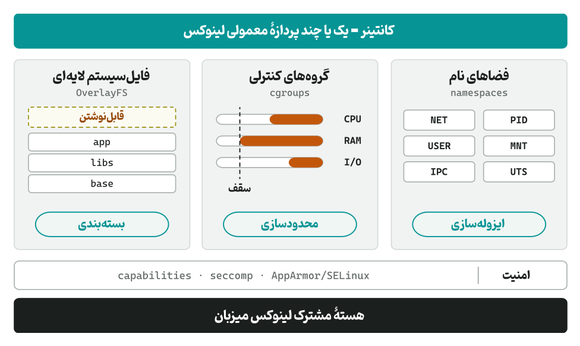
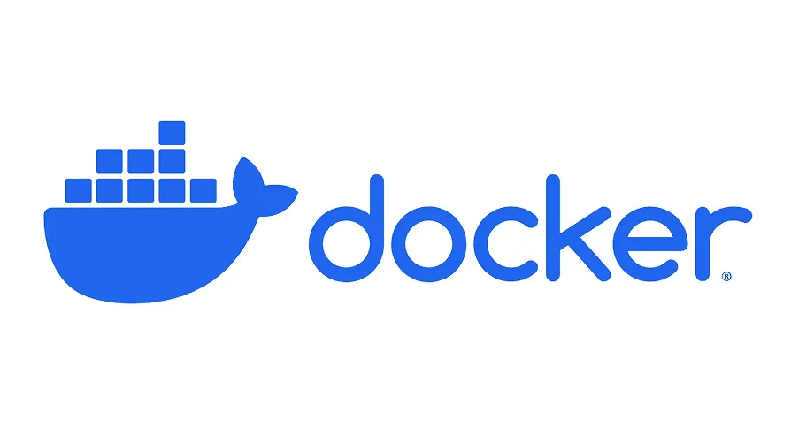
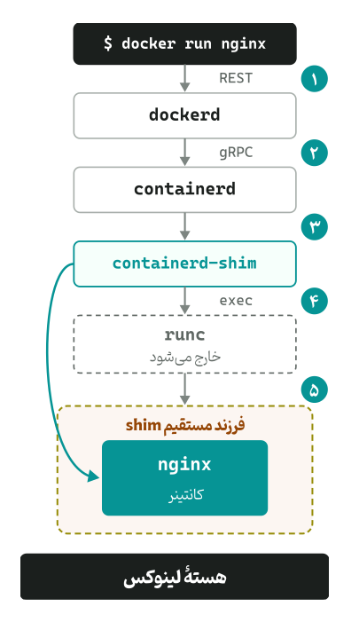
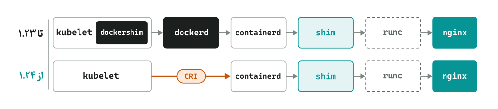
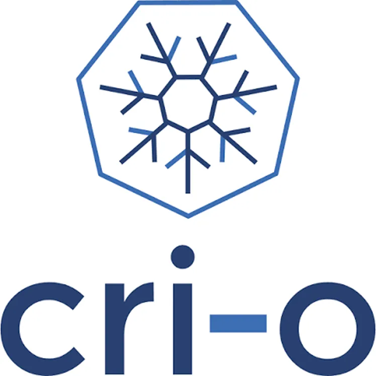
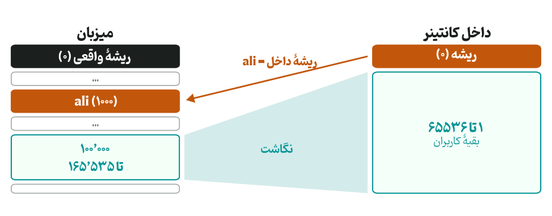
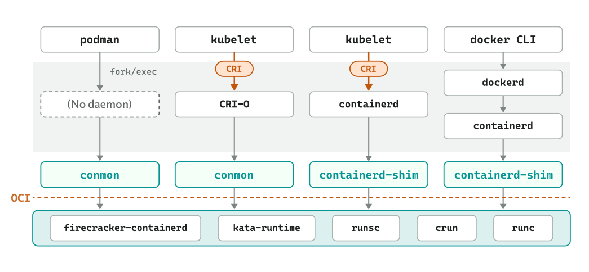
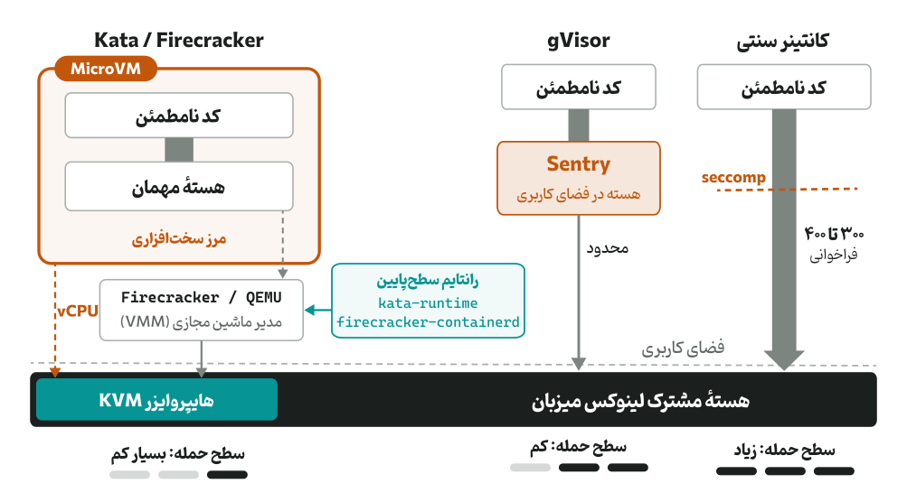
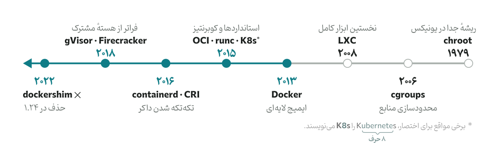

اگر تا به حال با ابزارهای کانتینری مانند داکر و کوبرنتیز کار کرده‌اید، ولی دقیقاً نمی‌دانید که چه اتفاقی در لایه‌های زیرین آن‌ها می‌افتد تا یک کانتینر را مدیریت کنند، شاید خواندن این متن برای شما خالی از لطف نباشد. شاید نام‌هایی مانند `containerd`، `dockershim`، `conmon`، `containerd-shim` یا `runc` و اصطلاحاتی مثل کانتینرهای Rootless به گوشتان خورده باشد، اما مرز دقیق بین آن‌ها و نقش هرکدام در این زیست‌بوم برایتان شفاف نباشد.

در این متن نمی‌خواهیم صرفاً یک مستند خشک از معرفی ابزارها ارائه دهیم؛ بلکه می‌خواهیم سیر تکامل مهندسی کانتینرها را دنبال کنیم. خواهیم دید که چطور داکر از یک برنامهٔ <Tooltip tip="Monolithic"><span>یکپارچه</span></Tooltip>، تکه‌تکه شد؛ چرا ورود کوبرنتیز و استاندارد <Tooltip tip="Container Runtime Interface"><span>CRI</span></Tooltip> معادلات را تغییر داد و ماجرای حذف `dockershim` چه بود. در ادامه بررسی می‌کنیم که چرا معماری سنتی داکر به‌دلیل نیاز به دسترسی سطح بالا، امروزه یک پاشنهٔ آشیل امنیتی محسوب می‌شود و چطور ابزارهای نسل جدید و Rootless این مشکل را حل کرده‌اند. در نهایت، به زمان حال و عصر <Tooltip tip="AI Agents"><span>عامل‌های هوش مصنوعی</span></Tooltip> می‌رسیم؛ جایی که حتی ایزوله‌سازی هستهٔ لینوکس هم کم می‌آورد و پای MicroVMها به میان کشیده می‌شود.

## کانتینر چیست و داکر دقیقاً چه چیزی را اختراع کرد؟

با یک جملهٔ غافلگیرکننده شروع می‌کنیم: **چیزی به اسم «کانتینر» در سطح هستهٔ لینوکس وجود خارجی ندارد!**

کانتینر سنتی در واقع از یک یا چند پردازهٔ معمولی لینوکسی تشکیل شده و بر **سه ستون** استوار است: ایزوله‌سازی، محدودسازی و بسته‌بندی که در ادامه به آن‌ها می‌رسیم؛

همه‌چیز از سال ۱۹۷۹ و فراخوانی سیستمی سادهٔ `chroot` در یونیکس شروع شد که اجازه می‌داد پوشهٔ ریشه (/) را برای یک پردازه تغییر دهیم تا نتواند بقیهٔ فایل‌های سیستم را ببیند. این ایده بعدها در دههٔ ۲۰۰۰ میلادی، در هستهٔ لینوکس به تکامل رسید:

- **ستون اول، <Tooltip tip="Namespaces (https://man7.org/linux/man-pages/man7/namespaces.7.html)"><span>فضاهای نام</span></Tooltip>:** این مکانیزم «دید» پردازه را نسبت به محیط اطرافش ایزوله می‌کند؛ به طوری که پردازه فکر می‌کند شبکه، فایل‌سیستم، لیست پردازه‌ها (PID) و کاربران مخصوص به خودش را دارد.
- **ستون دوم، <Tooltip tip="cgroups"><span>گروه‌های کنترلی</span></Tooltip>:** در سال ۲۰۰۶، مهندسان گوگل ‑که روی زیرساخت داخلی خودشان یعنی Borg، پدربزرگ کوبرنتیز، کار می‌کردند‑ متوجه شدند که ایزوله کردن دید پردازه کافی نیست؛ اگر یک پردازه کل CPU یا حافظهٔ میزبان را ببلعد چه؟ این‌جا `cgroups` متولد شد تا مصرف منابع سخت‌افزاری هر پردازه را محدود کند.

در کنار این دو، لایهٔ امنیتی شامل capabilities، seccomp و AppArmor/SELinux هم مشخص می‌کند پردازه مجاز به انجام چه کارهایی است؛ بعدتر دوباره به seccomp برمی‌گردیم.



در سال ۲۰۰۸، یعنی ۵ سال قبل از تولد داکر، پروژهٔ Linux Containers (به اختصار LXC) این دو قابلیت هستهٔ لینوکس را کنار هم گذاشت و نخستین ابزار کامل کانتینر لینوکسی بر پایهٔ هستهٔ اصلی (بدون نیاز به وصله‌های جانبی) را ساخت.

### چرا LXC فراگیر نشد، اما داکر در سال ۲۰۱۳ انقلابی به پا کرد؟

مشکل LXC این بود که کار کردن با آن به شدت سخت بود و کانتینرها را شبیه ماشین‌های مجازی و صرفاً نسخهٔ سبک‌تر آن‌ها می‌دید. یعنی اگر روی لپ‌تاپ خودتان یک کانتینر LXC می‌ساختید، انتقال دقیق آن به میزبان طاقت‌فرسا بود. شرکت dotCloud ‑که بعداً نامش را به Docker تغییر داد‑ تکهٔ سوم پازل، یعنی **«فایل‌سیستم لایه‌ای (UnionFS / OverlayFS)»** را اضافه کرد و **مفهوم Image** را وارد بازی کرد. این تکه دیگر ایزوله‌سازی نیست، بسته‌بندی است.

داکر، فایل‌سیستم کانتینر را به لایه‌های <Tooltip tip="Read-only"><span>فقط‌خواندنی</span></Tooltip> تبدیل کرد. حالا می‌شد کل محیط اجرای برنامه را در قالب یک بستهٔ استاندارد (Docker Image) بسته‌بندی کرد و دقیقاً مثل کدهای گیت، آن را روی هر بستر دلخواه، Push و Pull کرد. عملاً داکر تمام پیچیدگی‌های هسته و LXC را پشت یک ابزار ترمینالی ساده (`docker run`) پنهان می‌کرد.

البته در بخش پایانی این متن، نسل جدیدی از کانتینرها را معرفی خواهیم کرد که این تعریف سه‌گانه را هم به چالش می‌کشند. اما فعلاً می‌خواهیم بررسی کنیم بعد از این، چه بر سر معماری داکر آمد.

<div style={{ width: "50%", margin: "0 auto" }}>



</div>

## کالبدشکافی یک غول: چرا داکر تکه‌تکه شد؟

در سال‌های ابتدایی (۲۰۱۳ و ۲۰۱۴)، داکر یک برنامهٔ یکپارچه بود. یک سرویس واحد و غول‌پیکر به نام <Tooltip tip="Docker daemon"><span>`dockerd`</span></Tooltip> روی میزبان اجرا می‌شد و صفر تا صد کارها را یک‌تنه انجام می‌داد؛ از گرفتن <Tooltip tip="قابل توجه است که دستورات خط فرمان docker با REST API به dockerd رسیده و توسط آن اجرا می‌شوند."><span>دستورات کاربر</span></Tooltip> و دانلود ایمیج گرفته، تا تنظیم شبکه و ساختن خود کانتینر در هسته که ابتدا با کمک همان LXC و کمی بعدتر با کتابخانهٔ اختصاصی داکر به نام `libcontainer` انجام می‌شد. اما هرچقدر داکر محبوب‌تر شد، این معماری یکپارچه دو بحران بزرگ به بار آورد:

### بحران اول: انحصار!

شاید تصور می‌کردید این بحران‌ها هر دو فنی هستند! اما بحران اول که غیرفنی بود، انحصار بود. داکر با سرعتی سرسام‌آور در حال بلعیدن بازار بود و قابلیت‌های بیشتری را مستقیم داخل همان daemon مرکزی اضافه می‌کرد (که بعدتر در ۲۰۱۶، Docker Swarm هم به آن‌ها اضافه شد). غول‌های دیگر تکنولوژی مثل گوگل، Red Hat و شرکت CoreOS (که یک موتور کانتینری رقیب به نام `rkt` ساخته بود) احساس خطر کردند؛ کل دنیا به ابزاری وابسته شده بود که تحت کنترل یک شرکت خاص قرار داشت و هیچ استاندارد رسمی‌ای برای اینکه «کانتینر و ایمیج دقیقاً چه ساختاری دارند» وجود نداشت.

در سال ۲۰۱۵، برای جلوگیری از واگرا شدن زیست‌بوم، کنسرسیومی به نام <Tooltip tip="Open Container Initiative"><span>OCI</span></Tooltip> تحت نظر بنیاد لینوکس شکل گرفت. استاندارد OCI ابتدا دو چیز را مشخص کرد: یکی **Image Spec**، یعنی ساختار لایه‌های ایمیج، و دیگری **Runtime Spec** که نحوهٔ اجرای یک **<Tooltip tip="Bundle"><span>باندل</span></Tooltip>** را تعریف می‌کند. باندل پوشه‌ای است که فایل تنظیمات استاندارد `config.json` و فایل‌سیستم ریشهٔ کانتینر را در بر می‌گیرد. (چند سال بعد، **Distribution Spec** هم برای توزیع ایمیج‌ها در رجیستری‌ها اضافه شد.)

در این راستا، داکر هم قدم بزرگی برداشت؛ بخش زیرین کدهای خودش، یعنی `libcontainer` را که مسئول مستقیم تعامل با هستهٔ لینوکس بود، از دل daemon یکپارچه بیرون کشید و در قالب یک ابزار کوچک و مستقل به نام `runc` به جامعهٔ متن‌باز اهدا کرد.

این‌جا بود که مفهوم **Low-level Runtime** شکل گرفت. کار یک Low-level Runtime (مثل `runc` که به زبان Go است یا جایگزین‌های سریع‌ترش مثل `crun` که توسط Red Hat و به زبان C نوشته شده است) فقط این است: یک OCI Runtime Spec تحویل بگیرد، فراخوانی‌های سیستمی لازم برای ساختن فضاهای نام و گروه‌های کنترلی را صدا بزند، و پردازه را راه‌اندازی کند!

### بحران دوم: یک <Tooltip tip="Single point of failure"><span>نقطهٔ شکست واحد</span></Tooltip>

برخلاف بحران اول، بحران دوم کاملاً فنی و یک مشکل عملیاتی بود. در معماری اولیه، تمام کانتینرهای در حال اجرا، <Tooltip tip="Child process"><span>پردازهٔ فرزند</span></Tooltip> مستقیم daemon داکر بودند. این یعنی اگر `dockerd` به‌دلیل یک باگ دچار <Tooltip tip="Crash"><span>مشکل</span></Tooltip> می‌شد، یا اگر مدیر میزبان می‌خواست نسخهٔ داکر را به‌روزرسانی کند، تمام کانتینرهای در حال اجرا روی میزبان هم کشته می‌شدند!

شاید برایتان سؤال شود که چرا این اتفاق می‌افتد؟ مگر در لینوکس وقتی والد یک پردازه می‌میرد، آن پردازه <Tooltip tip="Orphan"><span>«یتیم»</span></Tooltip> نمی‌شود و <Tooltip tip="Root process (PID=1)"><span>پردازهٔ ریشه</span></Tooltip> سرپرستی‌اش را به عهده نمی‌گیرد تا به کارش ادامه دهد؟

چرا، در حالت عادی همین‌طور است! اما مشکل از دو جا ناشی می‌شد: **اول** اینکه `dockerd` برای جمع‌آوری <Tooltip tip="Logs"><span>گزارش‌های</span></Tooltip> کانتینر، <Tooltip tip="Standard I/O streams (stdin/stdout/stderr)"><span>جریان‌های ورودی و خروجی استاندارد</span></Tooltip> کانتینر را از طریق <Tooltip tip="Pipes"><span>لوله‌های</span></Tooltip> ارتباطی به خودش وصل می‌کرد. با مردن `dockerd`، سر دیگر این لوله‌ها بسته می‌شد و به محض اینکه کانتینر می‌خواست گزارش جدیدی چاپ کند، هستهٔ لینوکس سیگنال SIGPIPE را به کانتینر می‌فرستاد و آن را می‌کشت! **دوم** اینکه اگر کانتینر واقعاً به پردازهٔ ریشهٔ سیستم‌عامل به ارث می‌رسید، `dockerd` پس از بالا آمدن مجدد، دیگر نمی‌توانست کانتینر یتیم‌شده را پیدا کند و <Tooltip tip="Exit code / Error code"><span>کد خروج</span></Tooltip> آن را از هسته بگیرد.

برای حل این مشکل در سال ۲۰۱۶، مهندسان داکر تصمیم گرفتند daemon خود را باز هم کوچک‌تر کنند. آن‌ها تمام منطق مربوط به مدیریت چرخهٔ حیات کانتینر (از دانلود ایمیج و مدیریت فضای ذخیره‌سازی گرفته تا صدا زدن `runc`) را جدا کردند و به سرویس مستقلی به نام `containerd` سپردند (که آن هم کمی بعد در ۲۰۱۷ به بنیاد CNCF اهدا شد). این‌جا بود که مفهوم **High-level Runtime** پدیدار شد؛ مؤلفه‌ای که چرخهٔ حیات کانتینر را مدیریت می‌کند؛ یعنی ایمیج‌ها را دریافت و ذخیره می‌کند، باندل را آماده می‌کند و برای اجرا به یک Low-level Runtime تحویل می‌دهد.

اما برای اینکه خود containerd هم به سرنوشت `dockerd` دچار نشود و بتواند بدون کشتن کانتینرها <Tooltip tip="Restart"><span>بازراه‌اندازی</span></Tooltip> شود، قطعهٔ ظریفی به نام `containerd-shim` به معماری اضافه شد. در معماری جدید، به‌ازای هر کانتینر، یک پردازهٔ سبک به‌عنوان والد مستقیم آن کانتینر بالا می‌آید و تا لحظهٔ مرگ کانتینر بالای سرش می‌ماند. این پردازه، لوله‌های ورودی و خروجی کانتینر را باز نگه می‌دارد تا با بازراه‌اندازی `containerd`، کانتینر به‌دلیل سیگنال `SIGPIPE` نمیرد.

این shim یک وظیفهٔ دیگر هم دارد. `runc` بعد از راه‌اندازی کانتینر خارج می‌شود و پردازهٔ اصلی کانتینر یتیم می‌ماند. shim با ثبت خود به‌عنوان subreaper در هستهٔ لینوکس، والد جدید این پردازه می‌شود تا به پردازهٔ ریشهٔ میزبان به ارث نرسد، و کد خروج آن را نگه می‌دارد تا هر وقت `containerd` بالا آمد و به آن مجدداً <Tooltip tip="Re-attach"><span>متصل</span></Tooltip> شد، گزارش را تحویلش دهد.

امروزه شما وقتی دستور `docker run` را می‌زنید، این زنجیره از اتفاقات رخ می‌دهد:

۱. ابزار خط فرمان داکر، درخواست شما را با REST API به `dockerd` می‌فرستد.

۲. `dockerd` که دیگر خودش درگیر جزئیات اجرا نمی‌شود، از طریق پروتکل gRPC به `containerd` می‌گوید: «این کانتینر را برایم بالا بیاور».

۳. سرویس `containerd` به‌ازای آن کانتینر شما، یک پردازهٔ واسط و سبک به نام `containerd-shim` ایجاد می‌کند.

۴. حالا این shim می‌رود و `runc` را صدا می‌زند.

۵. ابزار `runc` فضاهای نام و گروه‌های کنترلی را در هسته می‌سازد، برنامهٔ داخل کانتینر (مثلاً `nginx`) را راه‌اندازی می‌کند و بلافاصله خودش خارج می‌شود!

<div style={{ width: "50%", margin: "0 auto" }}>



</div>

<Callout type="tip">

دقت کنید که اگر قرار بود به‌ازای هر کانتینر، یک پردازهٔ `runc` (که به زبان Go نوشته شده است) در حافظه بماند، مصرف حافظهٔ میزبان سر به فلک می‌کشید.

</Callout>

به لطف این معماری چندلایه، امروز می‌توان daemon داکر یا `containerd` را روی میزبان بازراه‌اندازی یا به‌روزرسانی کرد درحالی‌که کانتینرها زیر سایهٔ `containerd-shim` بدون هیچ وقفه‌ای به کارشان ادامه می‌دهند.

درست زمانی که به نظر می‌رسید این معماری به کمال رسیده است، غول جدیدی به نام کوبرنتیز وارد میدان شد و معادلات کمی تغییر کرد.

## ورود کوبرنتیز به میدان: استاندارد CRI

وقتی گوگل کوبرنتیز را در میانهٔ ۲۰۱۵ معرفی کرد، داکر پادشاه بی‌رقیب دنیای کانتینرها بود. به همین دلیل، <Tooltip tip="Component"><span>مؤلفهٔ</span></Tooltip> `kubelet` (مأمور کوبرنتیز روی هر node که وظیفه دارد کانتینرها را بالا بیاورد) طوری نوشته شده بود که به‌طور مستقیم با `dockerd` صحبت می‌کرد. اما خیلی زود دو مشکل اساسی سر راه کوبرنتیز سبز شد:

اول اینکه موتورهای کانتینری دیگری (مثل `rkt`) هم وارد بازار شده بودند و توسعه‌دهندگان می‌خواستند از آن‌ها در کوبرنتیز استفاده کنند؛ این موضوع کدهای داخل `kubelet` را به کلاف سردرگمی از شرط‌های if/else برای پشتیبانی از ابزارهای مختلف تبدیل کرده بود.

دوم اینکه، داکر در اصل برای **انسان‌ها** طراحی شده بود و امکانات بی‌شماری مثل ابزار CLI، قابلیت ساخت ایمیج، شبکهٔ اختصاصی و Docker Swarm داشت؛ درحالی‌که کوبرنتیز یک <Tooltip tip="Orchestrator"><span>هماهنگ‌کنندهٔ</span></Tooltip> ماشینی بود و به هیچ‌کدام از این امکانات اضافه نیاز نداشت.

برای حل این تنگنا، تیم کوبرنتیز در سال ۲۰۱۶ یک استاندارد ارتباطی به نام CRI معرفی کرد که شامل دو سرویس اصلی بود: **ImageService** برای مدیریت ایمیج‌ها و **RuntimeService** برای مدیریت چرخهٔ حیات پادها و کانتینرها. در واقع کوبرنتیز با تعریف CRI (که یک پروتکل مبتنی بر gRPC است) عملاً اعلام کرد که کدهایش را برای هیچ ابزار خاصی تغییر نمی‌دهد و از آن پس `kubelet` فقط به زبان استاندارد CRI صحبت می‌کند. هر ابزاری که می‌خواهد زیر دست کوبرنتیز کار کند، باید این زبان را بفهمد.

### تولد و مرگ dockershim

معرفی CRI یک ایدهٔ مهندسی درخشان بود، اما یک مشکل این میان وجود داشت: تمام دنیا در زیر کوبرنتیز از داکر استفاده می‌کردند، ولی `dockerd` زبان CRI را نمی‌فهمید! برای اینکه کلاسترهای کاربران از کار نیفتند، تیم کوبرنتیز مجبور شد یک ماژول مترجم به نام `dockershim` داخل خود `kubelet` بنویسد تا زبان CRI را به زبان `dockerd` ترجمه کند.

<Callout type="tip">

دقت کنید که این `dockershim` هیچ ربطی به `containerd-shim` که بالاتر دیدیم ندارد! `containerd-shim` یک پردازهٔ سطح پایین و والد کانتینر است، اما `dockershim` صرفاً یک مترجم نرم‌افزاری بین کوبرنتیز (`kubelet`) و داکر (`dockerd`) بود.

</Callout>

نتیجهٔ این کار، یک زنجیرهٔ طولانی برای بالا آوردن یک کانتینر ساده در کوبرنتیز بود که امروزه حتی مضحک به نظر می‌رسد!

کم‌کم نگهداری از کدهای `dockershim` برای تیم کوبرنتیز به یک بار اضافی تبدیل شده بود. آن‌ها تصمیم گرفتند نگهداری از این کدها را کنار بگذارند و به‌طور مستقیم با خود `containerd` ارتباط برقرار کنند؛ در همین راستا افزونهٔ پشتیبانی از CRI به‌طور مستقیم به `containerd` اضافه شد و در نهایت در نسخهٔ ۱.۲۴ کوبرنتیز (سال ۲۰۲۲)، `dockershim` برای همیشه حذف شد تا زنجیرهٔ اجرای کانتینر در کوبرنتیز، کوتاه، سریع و تمیز شود.



### واکنش Red Hat: تولد CRI-O و conmon

هم‌زمان با این تحولات، شرکت Red Hat ایدهٔ رادیکال‌تری را مطرح کرد: اصلاً چرا از `containerd` استفاده کنیم که هم daemon زیرین داکر است و هم برای کوبرنتیز کار می‌کند؟ یک High-level Runtime می‌سازیم که از همان ابتدا، منحصراً برای استاندارد CRI کوبرنتیز طراحی شده باشد و هیچ قابلیت اضافه‌ای نداشته باشد.

نتیجهٔ این تفکر، تولد پروژه‌ای به نام **CRI-O** (ترکیب دو استاندارد CRI و OCI) بود. همچنین مهندسان Red Hat از containerd-shim (که به زبان Go نوشته شده است) استفاده نکردند؛ آن‌ها یک برنامهٔ بسیار سبک به زبان C به نام `conmon` (مخفف Container Monitor) نوشتند که دقیقاً همان نقش والد کانتینر، مدیریت گزارش‌ها و ثبت کد خروج را با مصرف حافظهٔ بسیار کمتر ایفا می‌کند.

<div style={{ width: "40%", margin: "0 auto" }}>



</div>

## پاشنهٔ آشیل امنیتی: چرا داشتن یک daemon با دسترسی ریشه ترسناک است؟

در بخش قبل دیدیم که چطور شرکت Red Hat برای محیط کوبرنتیز، CRI-O و conmon را معرفی کرد؛ اما داستان به این‌جا ختم نشد. مهندسان Red Hat نگاهشان را به سیستم‌های شخصی توسعه‌دهندگان و میزبان‌های تکی برگرداندند؛ جایی که همه از دستورات docker استفاده می‌کردند. آن‌ها یک پرسش بنیادی مطرح کردند: **«اصلاً چرا برای اجرای یک کانتینر، به یک سرویس پس‌زمینهٔ دائمی نیاز داریم؟»**

بیایید نگاه عمیق‌تری به معماری کلاینت-سروری داکر بیندازیم. وقتی شما در ترمینال دستور `docker run` را می‌زنید، ابزار خط فرمان داکر خودش هیچ کاری نمی‌کند؛ بلکه صرفاً یک درخواست از طریق سوکت یونیکس (`/var/run/docker.sock`) به daemon مرکزی می‌فرستد. این معماری دو مشکل بزرگ امنیتی و ساختاری دارد:

**۱. دسترسی مطلق و خطرناک:** daemon داکر با دسترسی کامل ریشه روی میزبان اجرا می‌شود. وقتی شما برای راحتی کار، یک کاربر را به گروه docker اضافه می‌کنید تا بدون زدن sudo دستورات داکر را اجرا کند، در واقع عملاً به آن کاربر دسترسی ریشه بدون نیاز به رمز عبور داده‌اید! کافی است دستور زیر در shell آن کاربر اجرا شود تا کل فایل‌سیستم میزبان را با دسترسی ریشه در اختیار بگیرد:

```bash
docker run -it -v /:/host alpine chroot /host
```

**۲. پاک شدن ردپا در سیستم‌عامل:** در لینوکس <Tooltip tip="Linux Audit (auditd)"><span>سامانهٔ ممیزی</span></Tooltip> وجود دارد که ثبت می‌کند کدام کاربر چه دستوری را اجرا کرده است. وقتی کاربر `ali` دستور `docker run` را می‌زند، صرفاً همین دستور برای او ثبت می‌شود؛ ولی اصل کار که ساختن کانتینر و بالا آمدن آن است، توسط `dockerd` انجام می‌شود؛ پس در گزارش امنیتی مربوط به آن، کاربر `root` ثبت می‌شود و نه `ali`؛ پس ردپای کاربر واقعی در گزارش‌های امنیتی هسته گم می‌شود.

### تولد Podman: بازگشت به فلسفهٔ اصیل یونیکس

برای حل این مشکلات، Red Hat ابزار Podman را معرفی کرد که کاملاً سازگار با دستورات داکر است (تا جایی که می‌توانید بنویسید `alias docker=podman`)، اما هیچ daemonای در پس‌زمینه ندارد!

Podman از معماری کلاینت-سرور استفاده نمی‌کند؛ این ابزار مدل سنتی Fork/Exec در لینوکس را به کار می‌گیرد. وقتی دستور `podman run` را می‌زنید، خود پردازهٔ Podman به‌طور مستقیم ابزارهای زیرین (`conmon` و `crun`) را به‌عنوان فرزند خودش ایجاد می‌کند. به محض اینکه کانتینر ساخته شد، پردازهٔ اصلی Podman و `crun` خارج می‌شوند و فقط `conmon` و کانتینر شما در حافظه با هویت همان کاربری که دستور را اجرا کرده است، باقی می‌مانند. در نتیجه هم ردپای کاربر در هسته حفظ می‌شود و هم هیچ daemon مرکزی و دائمی‌ای وجود ندارد که باعث ایجاد سطح حملهٔ بیشتر یا بروز خطا شود.

### جادوی کانتینرهای Rootless: وقتی کاربر ریشه، واقعاً ریشه نیست!

حذف daemon در Podman، دروازه را برای یکی از مهم‌ترین دستاوردهای امنیتی سال‌های اخیر باز کرد؛ **کانتینرهای Rootless**؛ قابلیتی که در Podman به صورت پیش‌فرض و ذاتی وجود دارد و بعدها به داکر و `containerd` هم اضافه شد.

ما می‌دانیم که در هستهٔ لینوکس، ساختن فضای نام شبکه یا <Tooltip tip="Mount"><span>سوار کردن</span></Tooltip> فایل‌سیستم نیازمند دسترسی ریشه است؛ پس چطور یک کاربر عادی و بدون دسترسی سطح بالا می‌تواند کانتینر بسازد؟ پاسخ در مکانیزم هوشمندانهٔ **<Tooltip tip="Users namespace"><span>فضای نام کاربرها</span></Tooltip>** نهفته است. این تنها فضای نامی در لینوکس است که یک کاربر عادی هم اجازه دارد آن را بسازد. وقتی یک کانتینر به صورت Rootless اجرا می‌شود، این اتفاقات می‌افتد:

بازه‌ای از شناسه‌های کاربری فرعی (مثلاً از ۱۰۰۰۰۰ تا ۱۶۵۵۳۵) که در فایل‌های `/etc/subuid` و `/etc/subgid` برای کاربر عادی تعریف شده است، توسط ابزارهای `newuidmap` و `newgidmap` خوانده می‌شود و این ابزارها یک جدول <Tooltip tip="Mapping"><span>نگاشت</span></Tooltip> برای فضای نام کاربر می‌سازند؛ هسته فقط همین جدول را اعمال می‌کند.

**از دید داخل کانتینر:** پردازه فکر می‌کند کاربر ریشه (UID=0) است و تمام مجوزهای لازم برای نصب بسته یا تغییر فایل‌های داخل کانتینر را دارد.

**از دید هستهٔ میزبان:** همان پردازهٔ ریشهٔ داخل کانتینر، در واقعیت یک پردازهٔ معمولی با شناسهٔ خود کاربر عادی شما (مثلاً ۱۰۰۰) است؛ و بقیهٔ شناسه‌های داخل کانتینر (۱ به بعد) روی بازهٔ فرعی (۱۰۰۰۰۰ به بعد) نگاشت می‌شوند.



ارزش این کار زمانی مشخص می‌شود که یک آسیب‌پذیری امنیتی رخ دهد. در کانتینرهای سنتی که با daemon راه‌اندازی شده‌اند، اگر مهاجم موفق می‌شد با دور زدن ایزوله‌سازی، <Tooltip tip="Container Escape"><span>از کانتینر فرار کند</span></Tooltip>، روی میزبان هم دسترسی ریشه داشت و کل میزبان را تسخیر می‌کرد؛ اما در یک کانتینر Rootless، مهاجم روی میزبان فقط همان دسترسی‌های کاربری را دارد که کانتینر را اجرا کرده است و به فایل‌های سیستمی و سایر کاربران دسترسی ندارد. این خیلی بهتر از دسترسی ریشه است.

البته دنیای Rootless بدون چالش هم نیست. برای مثال، از آنجا که یک کاربر عادی اجازه ندارد در فضای نام اصلی میزبان کارت شبکهٔ مجازی بسازد یا قوانین فایروال بنویسد، کانتینرهای Rootless برای اتصال به شبکه از ابزارهای خلاقانه‌ای در فضای کاربری مثل `slirp4netns` یا ابزار جدیدتر و سریع‌تر pasta استفاده می‌کنند که بسته‌های شبکهٔ کانتینر را در فضای کاربری می‌گیرند و به سوکت‌های شبکهٔ عادی روی میزبان ترجمه می‌کنند. توضیح دربارهٔ این ابزارها فعلاً در حوصلهٔ این متن نمی‌گنجد.

## وقتی هستهٔ لینوکس کم می‌آورد؛ انفجار CVEها، عصر عامل‌های هوشمند و ظهور MicroVM

بگذارید یک بازگشت به اوایل متن داشته باشیم؛ اگر خاطرتان باشد، گفتیم کانتینر در معنای سنتی خود، یک پردازهٔ معمولی است که با مکانیزم‌هایی نظیر فضاهای نام و گروه‌های کنترلی ایزوله شده است؛ و نیز گفتیم که در ادامه نسل جدیدی از کانتینرها را معرفی می‌کنیم که این تعریف را به چالش می‌کشند. در این بخش می‌خواهیم به این موضوع بپردازیم.

در تمام ابزارهایی که معرفی کردیم و پیشرفت‌هایی که از داکر تا Podman و کانتینرهای Rootless از آن‌ها نام بردیم، یک چیز مشترک بود؛ و آن هم **استفاده از هستهٔ لینوکس مشترک روی میزبان** توسط کانتینرها بود. هستهٔ لینوکس حدود ۳۰۰ تا ۴۰۰ فراخوانی سیستمی دارد؛ وقتی برنامه‌ای در داخل یک کانتینر بخواهد فایلی را بخواند، بسته‌ای را در شبکه جابه‌جا کند یا …، به‌طور مستقیم از طریق فراخوانی‌های سیستمی با هستهٔ اصلی میزبان در تعامل است. با وجود اینکه می‌توان با مکانیزم‌هایی مانند `seccomp`، برخی از فراخوانی‌ها را مسدود کرد، ولی باز هم این سطح تعامل وسیع با یک هستهٔ مشترک، یک سطح حملهٔ بسیار قابل توجه است.

### انفجار نرخ آسیب‌پذیری‌ها در هستهٔ لینوکس

شاید تا چند سال پیش، تکیه بر امنیت کانتینرهای سنتی، کافی به نظر می‌رسید؛ ولی در یکی دو سال اخیر، به‌دلیل ورود هوش مصنوعی به مباحث امنیتی و رشد نرخ کشف آسیب‌پذیری‌های جدید در هستهٔ لینوکس و ابزارهای دیگر، معادلات عوض شده است. امروزه با پیچیده‌تر شدن کدهای هسته (به‌خصوص در زیرسیستم‌هایی مانند `eBPF` و `io_uring`) و استفاده از هوش مصنوعی و ابزارهای خودکار کشف باگ و نیز تبدیل شدن تیم توسعه‌دهندگان هستهٔ لینوکس به <Tooltip tip="CVE Numbering Authority (CNA)"><span>مرجع رسمی ثبت آسیب‌پذیری</span></Tooltip>، شاهد یک انفجار واقعی در تعداد آسیب‌پذیری‌های ثبت‌شده برای هستهٔ لینوکس هستیم.

در چنین شرایطی، یک آسیب‌پذیری روز صفر، یا حتی باگی که <Tooltip tip="Patch"><span>وصله</span></Tooltip> شده ولی هنوز روی میزبان اعمال نشده است، کافی است تا پردازهٔ مهاجم با ارسال یک فراخوانی سیستمی معیوب، از باگ هسته <Tooltip tip="Exploit"><span>بهره‌برداری</span></Tooltip> کند و از فضای ایزولهٔ کانتینر و حتی محدودیت‌های Rootless فرار کند و دسترسی خود را <Tooltip tip="Privilege Escalation"><span>ارتقا</span></Tooltip> دهد. به‌ویژه آنکه خود مکانیزم فضای نام کاربران در کانتینرهای Rootless، با اعطای مجوزهای مجازی خاصی به کاربر عادی، بخش‌های پیچیده‌تری از کدهای هسته را در دسترس او قرار می‌دهد و عملاً سطح حملهٔ هسته را وسیع‌تر می‌کند.

### نیازمندی عامل‌های هوش مصنوعی و عوض شدن زمین بازی

فارغ از اینکه خود هسته می‌تواند آسیب‌پذیر باشد، الگوی استفاده از کانتینرها هم تغییر کرده است. در گذشتهٔ نزدیک، تقریباً همهٔ کدهایی که در کانتینر اجرا می‌شدند، عملاً قابل اعتماد بودند؛ زیرا یا توسط برنامه‌نویسان خود سازمان نوشته شده بودند یا توسط یک مرجع معتبر تأیید شده بودند و در نهایت با بررسی امنیت خود کد، می‌توانستیم اطمینان داشته باشیم که فراخوانی سیستمی نابه‌جایی انجام نمی‌دهد؛ ولی امروزه در عصر عامل‌های هوش مصنوعی، با استفادهٔ جدیدی از کانتینرها روبه‌رو هستیم. کاربری از هوش مصنوعی می‌خواهد مسئله‌ای را حل کند یا داده‌ای را تحلیل کند؛ عامل در لحظه یک تکه کد تولید کرده و در محیط ایزوله اجرا می‌کند و خروجی را برمی‌گرداند.

اجرای کدی که توسط هوش مصنوعی تولید شده ‑و ممکن است دارای خطا باشد یا در اثر حملهٔ تزریق پرامپت، حاوی دستورات مخرب باشد‑ عملاً معادل این است که به یک مهاجم ناشناس اجازه دهیم هر کدی که می‌خواهد روی میزبان اجرا کند.

در این شرایط، امنیت کانتینرهای سنتی دیگر کافی نیست! از طرفی استفاده از ماشین‌های مجازی سنتی که هستهٔ مجزا دارند هم به دلیل سنگین بودن و زمان بالا آمدن طولانی، برای این کاربردها مناسب نیست.

### زیبایی استانداردها؛ تعویض موتور در حین پرواز

این‌جاست که ارزش استانداردهایی که در بخش‌های قبلی به آن‌ها اشاره کردیم خودش را نشان می‌دهد. از آنجا که امروز همهٔ ابزارهای سطح بالا مانند کوبرنتیز و `containerd` با زبان استاندارد صحبت می‌کنند، ما می‌توانیم بدون اینکه نحوهٔ ساخت ایمیج یا دستوراتمان را تغییر دهیم، **صرفاً در پایین‌ترین لایه، Low-level Runtime را تغییر دهیم؛ یعنی به `containerd` بگوییم `runc` را با اجراکنندهٔ دیگری جایگزین کند که از هستهٔ میزبان استفاده نمی‌کند.**



امروزه چند رویکرد مهندسی برای جایگزینی این لایهٔ آخر و ساخت کانتینرهای فوق‌ایزوله وجود دارد. البته این مبحث بسیار جدیدی در دنیای مهندسی نرم‌افزار و سیستم‌عامل است و پژوهش‌ها و ابزارها در این زمینه بسیار جدید و با سرعت زیادی در حال توسعه‌اند.

### رویکرد اول، هسته در فضای کاربری

مهندسان گوگل برای حل مشکل هستهٔ مشترک، **پروژه‌ای به نام gVisor** (با اجراکنندهٔ استاندارد `runsc`) را خلق کردند. در این معماری، کانتینر اجازه ندارد به‌طور مستقیم با هستهٔ لینوکس میزبان صحبت کند؛ بلکه برنامه‌ای به نام **Sentry** (که به زبان امن Go نوشته شده است) مثل یک دیوار بین کانتینر و هستهٔ میزبان می‌نشیند. این برنامه خودش نقش یک هستهٔ شبیه‌سازی‌شده در فضای کاربری را بازی می‌کند و تمام فراخوانی‌های سیستمی کانتینر را جواب می‌دهد و خودش برای کارهای ضروری فقط از تعداد بسیار محدودی فراخوانی امن هستهٔ میزبان استفاده می‌کند. در نتیجه، حتی اگر کانتینر حاوی بدافزار باشد، سطح حمله به هستهٔ میزبان به شدت کوچک می‌شود.

### رویکرد دوم، استفاده از ماشین مجازی در لباس کانتینر

**ایدهٔ Kata Containers** ساده اما رادیکال است: وقتی دستور اجرای کانتینر را می‌دهید، Kata فضای نامی روی هستهٔ میزبان نمی‌سازد؛ در عوض، به کمک قابلیت مجازی‌سازی سخت‌افزاری لینوکس (<Tooltip tip="KVM: Kernel-based Virtual Machine"><span>KVM</span></Tooltip>)، در کسری از ثانیه یک ماشین مجازی فوق‌سبک بالا می‌آورد که هستهٔ لینوکس مجزا و اختصاصی خودش را دارد و کانتینر شما را درون آن اجرا می‌کند. از بیرون، شما و کوبرنتیز فکر می‌کنید با یک کانتینر معمولی طرف هستید، اما در باطن، یک دیوار سخت‌افزاری بسیار محکم‌تر بین کانتینر و میزبان کشیده شده است.

مکانیزم Kata برای بالا آوردن ماشین مجازی، نیاز به یک <Tooltip tip="VMM: Virtual Machine Manager"><span>مدیر ماشین مجازی</span></Tooltip> دارد که در فضای کاربری از KVM استفاده می‌کند؛ برای این کار می‌توان از QEMU بهره برد. اما وقتی شرکت آمازون (AWS) می‌خواست زیرساخت <Tooltip tip="AWS Serverless Services e.g. AWS Lambda"><span>سرویس‌های بدون سرور</span></Tooltip> خود را بسازد، و زمانی که سکوهای اجرای کد برای هوش مصنوعی به دنبال بستری برای اجرای کد تولیدشدهٔ آن‌ها بودند، به چیزی سریع‌تر نیاز داشتند. ماشین‌های مجازی سنتی (که از ابزاری مثل QEMU استفاده می‌کنند) کند هستند، چون کدهای مربوط به شبیه‌سازی صدها قطعهٔ سخت‌افزاری قدیمی (از کارت صدا و گرافیک گرفته تا فلاپی‌دیسک!) را در خود دارند.

این‌جا بود که مهندسان آمازون دست‌به‌کار شدند و با زبان Rust، یک مدیر ماشین مجازی حداقلی به نام **Firecracker** نوشتند که تمام قطعات اضافه را دور ریخته و فقط چند قطعهٔ حیاتی (شبکه، دیسک، vsock، کنسول سریال و یک کنترلر کیبورد حداقلی) را شبیه‌سازی می‌کند. این‌جا بود که MicroVM متولد شد؛ یک ماشین مجازی واقعی با هستهٔ مجزا که طبق ادعای مستندات رسمی آن، در کمتر از ۱۲۵ میلی‌ثانیه بوت می‌شود و تنها ۵ مگابایت سربار حافظه دارد! این مدیر ماشین مجازی را می‌توان هم در لایهٔ زیرین Kata Containers جایگزین QEMU کرد و هم از طریق پروژهٔ `firecracker-containerd` به‌طور مستقیم به `containerd` متصل نمود.

<Callout type="tip">

امروزه تقریباً تمام پلتفرم‌های مدرنی که محیط اجرای کد برای هوش مصنوعی فراهم می‌کنند (مانند E2B)، در لایهٔ زیرین خود به‌طور مستقیم از Firecracker بهره می‌برند.

</Callout>



## سخن پایانی

سفر ما از یک فراخوانی سیستمی سادهٔ **chroot** در سال ۱۹۷۹ شروع شد، به غول یکپارچه‌ای به نام **داکر** در سال ۲۰۱۳ رسید و دیدیم که چطور نیازهای عملیاتی و استانداردهای باز (OCI و CRI)، این غول را به قطعات کوچک، تخصصی و ماژولاری مثل `containerd`، `shim`، `runc` و `conmon` تقسیم کردند.

در نهایت، همین معماری لایه‌لایه به ما اجازه داد در مواجهه با انفجار آسیب‌پذیری‌های امنیتی، ابتدا به سراغ کانتینرهای Rootless برویم و امروز در عصر عامل‌های هوشمند، مرز بین «کانتینر» و «ماشین مجازی» را با MicroVMها بسیار کم‌رنگ کنیم؛ جایی که سرعت کانتینر و امنیت ماشین مجازی دیگر تا این اندازه در برابر یک‌دیگر قرار ندارند و تا حد زیادی در هم ادغام شده‌اند.


