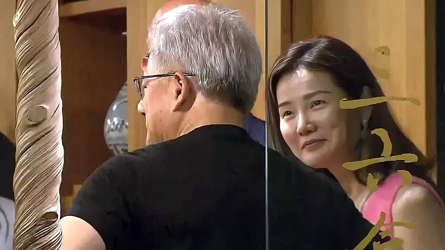
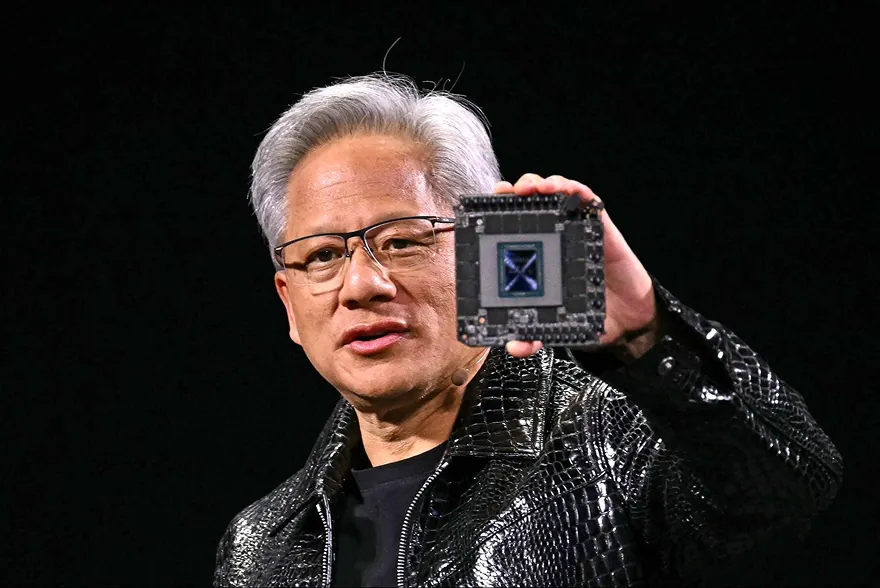

در نوامبر ۲۰۲۶، افشای رابطۀ خارج از ازدواج <Tooltip tip="Jensen Huang">جنسن هوانگ</Tooltip>، بنیان‌گذار و مدیرعامل انویدیا، به بحرانی فراتر از زندگی شخصی او تبدیل شد. ماجرا پای احتمال جاسوسی، رقابت آمریکا و چین و قاچاق احتمالی تراشه‌های پیشرفته را به میان کشید و نگرانی‌هایی دربارۀ امنیت اقتصادی یکی از ارزشمندترین شرکت‌های جهان پدید آورد. <Tooltip tip="Alice Huang">آلیس هوانگ</Tooltip> -معروف به Huang Le- فعال اقتصادی چینی و از مدیران سابق شرکت سنگاپوری Megaspeed International بود. این شرکت در حوزۀ زیرساخت پردازش ابری و تجهیزات هوش مصنوعی فعالیت داشت و با انویدیا ارتباط تجاری برقرار کرده بود. گزارش‌ها از ارتباط آلیس و جنسن هوانگ از سال ۲۰۲۴ حکایت داشتند و تصاویر حضور مشترک آن‌ها در تایوان نیز توجه رسانه‌ها را جلب کرد.

نیویورک‌تایمز مدعی شد نهادهای اطلاعاتی آمریکا آلیس را مرتبط با سرویس اطلاعاتی چین می‌دانند و معتقدند او اطلاعاتی به پکن منتقل کرده است. هوانگ در ۸ نوامبر ۲۰۲۶ به خیانت نسبت به همسرش اعتراف کرد و از خانواده و همکارانش عذرخواهی کرد. او از تحقیقات مستقل هیئت‌مدیره حمایت کرد؛ هیئت‌مدیره نیز کمیته‌ای متشکل از مدیران مستقل و مشاوران حقوقی خارجی برای بررسی احتمال نفوذ تشکیل داد. هوانگ اعلام کرد با این تحقیقات همکاری خواهد کرد. انویدیا تأکید کرد در آن زمان شواهدی که نشان دهد اسرار تجاری یا امنیت ملی آمریکا به خطر افتاده است، در اختیار ندارد.

Megaspeed در زنجیرۀ تأمین تراشه‌های انویدیا و خرید تجهیزات پیشرفته‌ای مانند H100 و H200 نقش داشت. با وجود محدودیت صادرات تراشه به چین، احتمال انتقال تجهیزات از طریق شرکت‌های واسطه مطرح شد و آمریکا و سنگاپور فعالیت‌های شرکت را بررسی کردند. بر اساس گزارش The Information که رویترز نیز آن را بازتاب داد، شبکۀ مرتبط با آلیس ممکن است در انتقال حدود ۲۴۰ هزار تراشۀ انویدیا به ارزش دست‌کم ۷٫۵ میلیارد دلار به شرکت‌های چینی نقش داشته باشد. این ادعا هنوز نتیجۀ قطعی تحقیقات نیست.

## تلهٔ عاطفی و جاسوسی صنعتی

در صورت اثبات نفوذ اطلاعاتی از مسیر رابطۀ شخصی، این پرونده می‌تواند نمونه‌ای از Honey Trap یا «تلۀ عاطفی» باشد.

در این روش، فرد با ایجاد رابطۀ عاشقانه، جنسی یا عاطفی اعتماد هدف را جلب می‌کند تا اطلاعات حساس بگیرد یا از نقاط ضعف او برای اعمال فشار استفاده کند.

این روش الزاماً به‌معنای اغواگری ساده نیست.

گاهی رابطه‌ای طولانی و ظاهراً طبیعی، بستر جمع‌آوری تدریجی اطلاعات می‌شود.

این روش سابقهٔ تاریخی دارد.

در جنگ سرد، <Tooltip tip="Stasi">اشتازی</Tooltip>، سازمان اطلاعاتی آلمان شرقی، از مأمورانی موسوم به Romeo Spies برای برقراری رابطه با زنان دارای دسترسی به اطلاعات محرمانه استفاده می‌کرد. رابطۀ <Tooltip tip="Bernard Boursicot">برنارد بورسی‌کو</Tooltip>، دیپلمات فرانسوی، با هنرمند چینی <Tooltip tip="Shi Pei Pu">شی پی‌پو</Tooltip> نیز به انتقال اسناد محرمانه به چین منجر شد.

پروندۀ <Tooltip tip="Christine Fang">کریستین فنگ</Tooltip> نمونۀ دیگری از تلاش برای ارتباط با سیاست‌مداران آمریکایی بود.

جاسوسی صنعتی از مسیر کارکنان نیز رخ می‌دهد.

در پروندۀ Micron، وزارت دادگستری آمریکا افراد و شرکت‌هایی را به سرقت اسرار فناوری حافظۀ DRAM و انتقال آن به <Tooltip tip="Fujian Jinhua">فوجیان جین‌هوا</Tooltip> متهم کرد. <Tooltip tip="Linwei Ding">لین‌وی دینگ</Tooltip>، مهندس سابق گوگل، نیز در ژانویۀ ۲۰۲۶ به اتهام سرقت اطلاعات محرمانۀ زیرساخت هوش مصنوعی و انتقال آن‌ها به‌نفع فعالیت‌های تجاری مرتبط با چین محکوم شد.

این اطلاعات شامل معماری پردازش، تراشه‌های اختصاصی و سامانه‌های آموزش مدل‌های هوش مصنوعی بود.

## پیامدهای بازار

پیامدهای بازار نیز چشمگیر بود.

اعتماد به مدیریت و امنیت اطلاعات بخشی از ارزش اقتصادی شرکت است و فقط درآمد، فناوری و سهم بازار اهمیت ندارند. هرگونه تردید در این حوزه‌ها می‌تواند اعتماد سرمایه‌گذاران را تضعیف کرده و پیامدهای مالی گسترده‌ای به همراه داشته باشد.

پس از انتشار خبر تحقیقات، سهام انویدیا در ۹ نوامبر حدود ۴٫۳ درصد افت کرد و نزدیک به ۱۹۰ میلیارد دلار از ارزش بازار آن کاسته شد. در روز بعد نیز فشار فروش ادامه یافت. در ۱۲ نوامبر، پس از گزارش‌هایی درباره آیندۀ مدیریتی هوانگ و ادعاهای رابطه‌ای دیگر، سهام شرکت در معاملات خارج از ساعت رسمی حدود ۸٫۶ درصد افت کرد.

این افت‌ها را نمی‌توان صرفاً به رابطه‌ای شخصی نسبت داد؛ نگرانی دربارۀ مدیریت، محدودیت‌های تجاری، دعاوی سهام‌داران و ارزش‌گذاری شرکت‌های هوش مصنوعی نیز نقش داشتند. هوانگ معمار استراتژی انویدیا است و تردید دربارۀ موقعیت او می‌تواند بر انتظارات سرمایه‌گذاران اثر بگذارد. هنوز میزان انتقال اطلاعات یا وقوع عملیات جاسوسی سازمان‌یافته روشن نیست؛ اما پرونده نشان می‌دهد در رقابت فناوری، روابط انسانی و زنجیرۀ تأمین نیز در کنار سرورها و کدها اهمیت امنیتی دارند. همین احتمال نیز برای شکل‌گیری بحرانی هم‌زمان در مدیریت، امنیت و بازار سرمایه کافی بوده است.

