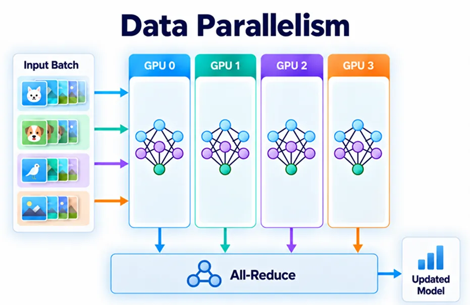
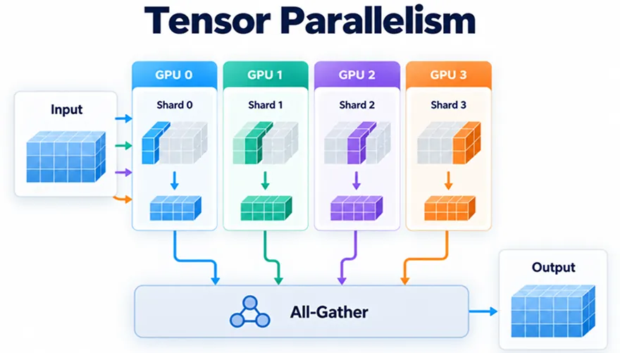
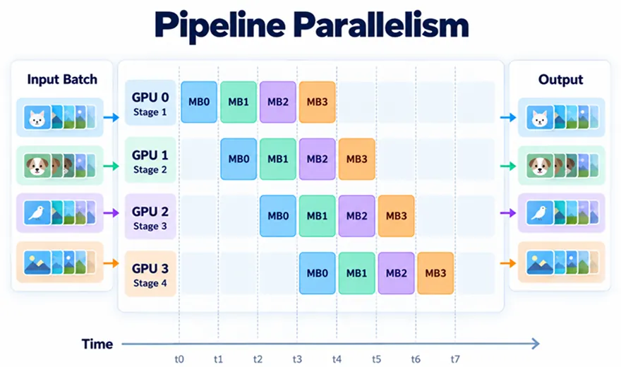
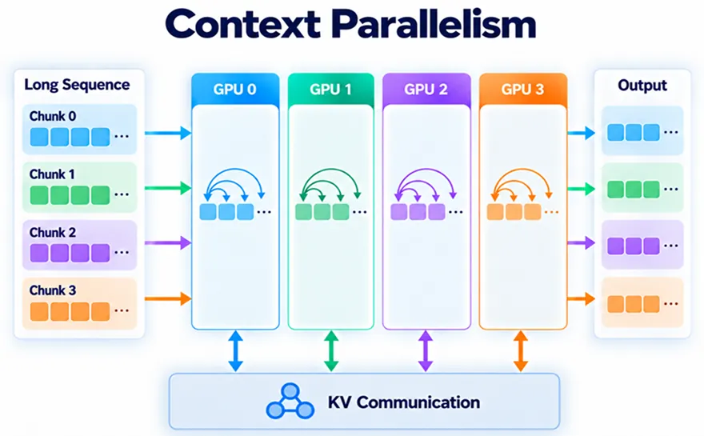
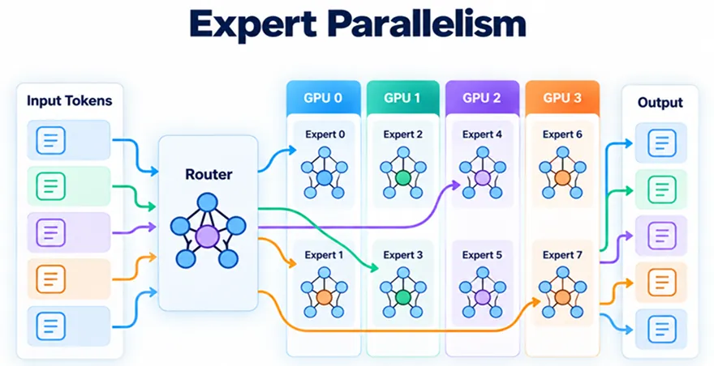

امروزه می‌بینیم که در دنیای <Tooltip tip="Large Language Models">LLM‌ها</Tooltip> و <Tooltip tip="Large Multimodal Models">LMM‌ها</Tooltip>، در میان مدل‌های وزن‌باز، گاهی مدل‌های غول‌پیکری با چند صد میلیارد یا حتی چند تریلیون پارامتر نیز منتشر می‌شوند؛ شاید نتوانیم با یک واحد از منابع محاسباتی موجودمان -مثل GPU-، آن‌ها را لود کرده و fine-tune شان کنیم یا برای inference از آن‌ها استفاده کنیم.

این‌جاست که استفاده از چندین GPU ضروری می‌شود. حتی گاهی اندازۀ مدل به این بزرگی نیست، اما می‌خواهیم برای تجربۀ بهتر کاربری، نرخ پردازش درخواست‌ها را افزایش دهیم یا برای batch inference در یک پروژه، سرعت را افزایش دهیم.

در این متن می‌خواهم به برخی از مهم‌ترین روش‌های محاسبات Multi-GPU اشاره کنم. برای درک بهتر تفاوت این روش‌ها، ابتدا باید به این پرسش پاسخ بدهیم: «در روش x، دقیقاً چه چیزی را بین GPU‌ها تقسیم می‌کنیم؟»

متداول‌ترین پاسخ‌هایی که می‌توان داد، این‌ها هستند: خود داده‌ها، مجموعۀ لایه‌های مدل، تنسورهای هر لایه از مدل و یا بخش‌های مختلف یک دنباله مثل متن (دنباله‌ای از توکن‌ها).

## پیش از شروع

در محاسبات Multi-GPU، معمولاً هر GPU توسط یک <Tooltip tip="Process">فرایند</Tooltip> مدیریت می‌شود و هر فرایند هم یک شناسه به نام Rank دارد. مثلاً در یک اجرا با چهار GPU، معمولاً Rank‌های صفر تا سه داریم.

این فرایندها لازم دارند در طول آموزش و inference، مرتب با یک‌دیگر داده ردوبدل کنند. پنج عملیات ارتباطی مهمی را که در روش‌ها هم خواهیم دید، در ادامه آورده‌ام.

- **All-Reduce:** هر GPU مقدارهایی مثل گرادیان‌های محاسبه‌شده روی داده‌های خودش را دارد؛ این مقادیر با عملیات جمع یا میانگین، ترکیب می‌شوند و نتیجۀ نهایی دوباره به همۀ GPU‌ها می‌رسد.
- **All-Gather:** هر GPU فقط بخشی از داده را نگه داشته‌است و با این عملیات، همۀ بخش‌ها تجمیع می‌شوند تا هر GPU به‌طور موقت یک نسخۀ کامل از دادۀ همۀ GPU‌ها را داشته باشد.
- **Reduce-Scatter:** ابتدا داده‌های GPU‌ها را با هم ترکیب می‌کند و سپس نتیجه را دوباره به بخش‌هایی تقسیم می‌کند و هر بخش را فقط به یک GPU ارسال می‌کند.
- **Point-to-Point:** خروجی هر بخش از یک GPU به یکی از GPU‌های دیگر فرستاده می‌شود.
- **All-to-All:** هر GPU دادۀ خود را به چند بخش تقسیم می‌کند و هر بخش را برای GPU مقصد مربوطه می‌فرستد؛ در پایان نیز، هر GPU مجموعه‌ای از بخش‌ها را از همۀ GPU‌های دیگر دریافت می‌کند.

خالی از لطف نیست بگوییم که این ارتباط فرایندها هزینه دارد و به همین دلیل، نوع اتصال GPU‌ها -مثلاً PCIe در برابر NVLink یا NVSwitch- می‌تواند تأثیر زیادی بر کارایی واقعی هر یک از این روش‌ها داشته باشد.

## ۱. موازی‌سازی داده (<Tooltip tip="Data Parallelism">DP</Tooltip>)

فرض کنید چهار GPU داریم و مدل ما به‌راحتی روی <Tooltip tip="Video Random Access Memory">VRAM</Tooltip> هر GPU جا می‌شود یا به‌اصطلاح لود می‌شود. در این روش، ما یک نسخۀ کامل از مدل را روی هر GPU قرار می‌دهیم و batch‌های دادۀ خود را میان آن‌ها تقسیم می‌کنیم تا عملیات forward به‌طور جداگانه روی آن‌ها اجرا شود.

اگر در حال آموزش یا fine-tune مدل باشیم، مرحلۀ backward هر کدام نیز جداگانه انجام می‌شود تا گرادیان‌ها مشخص شوند و سپس با استفاده از All-Reduce، گرادیان‌ها با یک‌دیگر تجمیع می‌شوند و حاصل به هر GPU داده می‌شود تا نسخه‌های مدل با گرادیان یکسان به‌روز شوند و عملاً با یک نسخۀ واحد، امکان ادامۀ آموزش فراهم می‌شود.

خب، کاربرد این روش چیست؟ درست حدس زدید، این روش مشکل کمبود حافظه را حل نمی‌کند، یعنی اگر کل مدل روی هر GPU جا نشود، کاری از دست این روش ساخته نیست؛ اما می‌تواند توان پردازشی بیش‌تری در اختیارمان بگذارد تا نمونه‌های بیش‌تری را در واحد زمان پردازش کنیم.

## ۲. بهبود موازی‌سازی داده

یکی از مشکل‌های روش قبلی این است که همه‌چیز مدل -پارامترها، گرادیان‌ها و وضعیت‌های <Tooltip tip="Optimizer">بهینه‌ساز</Tooltip>- روی تمام GPU‌ها تکرار می‌شود و این می‌تواند موجب هدر‌رفت بخش زیادی از حافظه شود.

یک دسته از راهکارهای موجود برای این چالش، روش‌هایی مثل <Tooltip tip="Zero Redundancy Optimizer">ZeRO</Tooltip> (راهکار لایبرری DeepSpeed) و <Tooltip tip="Fully Shared Data Parallel">FSDP</Tooltip> (راهکار خود PyTorch) هستند. ایدۀ کلی‌شان این است که به‌جای ذخیرۀ کامل موارد بالا روی هر GPU، آن‌ها را اصطلاحاً بین GPU‌ها shard یا تقسیم کنیم و هر GPU فقط بخشی از آن‌ها را نگه دارد؛ هنگام اجرای هر بخش از مدل، پارامترهای لازم به‌طور موقت با All-Gather بازسازی می‌شوند و پس از انجام محاسبات، پارامترها با Reduce-Scatter دوباره میان GPU‌ها تقسیم می‌شوند.

با این وجود، این روش‌ها همچنان نوعی موازی‌سازی داده محسوب می‌شوند؛ چون هر GPU بخش متفاوتی از batch را پردازش می‌کند و از نظر منطقی همان مدل را روی داده‌های خودش اجرا می‌کند. تقسیم‌بندی فقط نحوۀ نگه‌داری و تبادل وضعیت مدل را تغییر می‌دهد.

در مورد ZeRO، سه حالت کلی قابل‌استفاده هستند: ZeRO-1 فقط وضعیت بهینه‌ساز را تقسیم می‌کند، ZeRO-2 گرادیان‌ها را هم تقسیم می‌کند و ZeRO-3 علاوه‌بر آن‌ها پارامترها را هم تقسیم می‌کند. FSDP نیز چند حالت مختلف دارد که در حالت fully sharded، شباهت زیادی به ZeRO-3 دارد.

## ۳. موازی‌سازی تنسور (<Tooltip tip="Tensor Parallelism">TP</Tooltip>)

فرض کنید در یک مدل با معماری ترنسفورمر، یک ماتریس وزن بسیار بزرگ داریم و محاسبه‌ای به‌صورت Y=XW وجود دارد. ایدۀ این روش این است که خود ماتریس وزن W را بین چند GPU تقسیم کنیم. مثلاً هر GPU بخشی از ستون‌ها یا سطرهای ماتریس را نگه می‌دارد و فقط قسمت مربوط به خودش از ضرب ماتریسی را انجام می‌دهد؛ سپس خروجی‌های حاصل با عملیات ارتباطی مناسب کنار هم قرار می‌گیرند یا تجمیع می‌شوند تا Y نهایی را تشکیل دهند.

در مدل‌های ترنسفورمری، پروجکشن‌های <Tooltip tip="Query/Key/Value">کوئری، کلید و مقدار</Tooltip> در مکانیزم <Tooltip tip="Attention">توجه</Tooltip> و همچنین لایه‌های <Tooltip tip="Multi-Layer Perceptron">MLP</Tooltip> می‌توانند میان چند GPU تقسیم شوند.

همان‌طور که گفته شد، موازی‌سازی داده به‌تنهایی برای مدل‌هایی که روی یک GPU جا نمی‌شوند، کارساز نبود. اما مزیت اصلی موازی‌سازی تنسور این است که می‌توان مدلی با لایه‌های بسیار بزرگ را روی چند GPU پخش کرد. البته هزینۀ این قابلیت، ارتباط زیاد بین GPU‌هاست؛ چون تقریباً در هر لایه نیاز به تبادل داده وجود دارد. به همین دلیل، این روش روی GPU‌هایی که اتصال سریع مثل NVLink دارند، بسیار بهتر عمل می‌کند.

## ۴. موازی‌سازی پایپ‌لاین (<Tooltip tip="Pipeline Parallelism">PP</Tooltip>)

شیوه‌ای دیگر از محاسبات Multi-GPU که می‌تواند برای مدل‌های عظیم مفید واقع شود، موازی‌سازی پایپ‌لاین است. در این روش، به‌جای شکستن ماتریس وزن هر لایه، مجموعۀ لایه‌ها را بین GPU‌ها تقسیم می‌کنیم. مثلاً در یک مدل ترنسفورمری چهل‌لایه‌ای، GPU اول می‌تواند لایه‌های صفر تا ۹ را اجرا کند، GPU دوم لایه‌های ۱۰ تا ۱۹ و همین‌طور تا آخر. خروجی هر بخش معمولاً با یک ارتباط Point-to-Point به GPU مسئول بخش بعدی فرستاده می‌شود؛ در مرحلۀ backward هم گرادیان‌ها در جهت عکس بین بخش‌ها منتقل می‌شوند.

چالش این روش این است که وقتی می‌خواهیم یک batch را یک‌جا از این پایپ‌لاین عبور دهیم، داده‌ها باید به ترتیب مشخص‌شده از همۀ GPU‌ها عبور کنند و طبیعتاً وقتی داده‌ها در حال پردازش در یکی از GPU‌ها هستند، GPU‌های دیگر بی‌کارند. برای حل این مشکل می‌توان یک batch را به چند micro-batch تقسیم کرد و به‌ترتیب، به مدل ورودی داد؛ حالا وقتی GPU دوم مشغول پردازش micro-batch اول است، GPU اول می‌تواند کار روی micro-batch دوم را شروع کند و بی‌کار نماند؛ درست مثل ایدۀ پایپ‌لاین دستورات در معماری کامپیوتر!

## ۵. موازی‌سازی <Tooltip tip="Sequence Parallelism">دنباله</Tooltip> و <Tooltip tip="Context Parallelism">کانتکست</Tooltip>

گاهی مشکل اصلی اندازۀ مدل نیست، بلکه طول ورودی است. در مدل‌های ترنسفورمری هرچه دنباله (مثلاً متن) طولانی‌تر شود، حافظۀ مورد نیاز برای <Tooltip tip="Activations">فعال‌سازی‌ها</Tooltip> افزایش می‌یابد و هزینۀ محاسبات توجه نیز به‌شدت رشد می‌کند.

در موازی‌سازی دنباله، بعضی محاسباتی که روی هر توکن تقریباً مستقل انجام می‌شوند -مثل LayerNorm و Dropout- در امتداد بُعد دنباله تقسیم می‌شوند. مثلاً اگر ۸۰۰۰ توکن و چهار GPU داشته باشیم، هر GPU می‌تواند فعال‌سازی مربوط به حدود ۲۰۰۰ توکن را نگه دارد و همان بخش را پردازش کند. هدف اصلی این روش، کاهش حافظۀ فعال‌سازی است؛ در این حالت، خودِ توجه، لزوماً به‌طور کامل بین GPU‌ها تقسیم نشده است.

در موازی‌سازی کانتکست، تقسیم عمیق‌تر است: خود توکن‌های کانتکست و معمولاً کلیدها و مقادیر توجه بین GPU‌ها پخش می‌شوند. در همان مثال بند قبل، هر GPU دو هزار توکن را در اختیار دارد، اما کوئری‌های آن باید بتوانند به توکن‌های سه GPU دیگر هم توجه کنند. بنابراین GPU‌ها باید اطلاعات کلید و مقدار را با یک‌دیگر مبادله کنند. اگر علاقه‌مندید، می‌توانید روش‌هایی مثل Ring Attention و DeepSpeed-Ulysses را برای توزیع توجه روی دنباله‌های بسیار بلند مطالعه کنید. البته دقت کنید که نام‌گذاری SP و CP در همۀ منابع کاملاً یکسان نیست.

به‌طور خلاصه، SP بیشتر برای کم‌کردن حافظۀ فعال‌سازی است، در حالی که CP خودِ توجه روی کانتکست‌های بسیار بلند را بین چند GPU توزیع می‌کند.

## ۶. موازی‌سازی متخصص (<Tooltip tip="Expert Parallelism">EP</Tooltip>)

ابتدا بیایید نگاهی به تعریف مدل‌های <Tooltip tip="Mixture of Experts">MoE</Tooltip> بیندازیم. در معماری MoE، به‌جای این‌که همۀ ورودی‌ها از یک مسیر محاسباتی یکسان عبور کنند، چندین شبکۀ کوچک‌تر یا «متخصص» داریم و یک روتر مشخص می‌کند هر توکن توسط کدام متخصص یا متخصص‌ها پردازش شود. به این ترتیب، مدل می‌تواند تعداد پارامتر بسیار زیادی داشته باشد، بدون این‌که برای هر توکن لازم باشد همۀ آن‌ها فعال باشند. این معماری اجازه می‌دهد متخصص‌ها را بین GPU‌های مختلف تقسیم کنیم.

فرض کنید ۸ متخصص و چهار GPU داریم؛ هر GPU دو متخصص را نگه می‌دارد. روتر برای هر توکن امتیاز متخصص‌ها را محاسبه می‌کند. مثلاً ممکن است توکن اول به متخصص‌های ۲ و ۱۰ و توکن دوم به متخصص‌های ۵ و ۶ فرستاده شوند. چون این متخصص‌ها ممکن است روی GPU‌های دیگری باشند، توکن‌ها با عملیاتی مثل All-to-All به GPU مالک متخصص فرستاده می‌شوند. آن GPU محاسبۀ متخصص را انجام می‌دهد و خروجی دوباره به محل اصلی توکن بازگردانده می‌شود.

چالش مهم این روش <Tooltip tip="Load Balancing">توازن بار</Tooltip> است. اگر روتر تعداد زیادی توکن را به یک متخصص خاص بفرستد، GPU آن تبدیل به گلوگاه می‌شود، در حالی که GPU‌های دیگر ممکن است ظرفیت خالی داشته باشند.

## پیشنهاد سرآشپز: ترکیب روش‌ها

در مدل‌های بسیار بزرگ معمولاً یک نوع موازی‌سازی به‌تنهایی کافی نیست و چند روش روی ابعاد مختلف با هم ترکیب می‌شوند. مثلاً اگر تنظیمات [DP=2, TP=4, PP=3] را داشته باشیم، در مجموع به ۲۴=۳×۴×۲ تا GPU نیاز داریم. مدل ابتدا از نظر عمق به سه بخش برای پایپ‌لاین تقسیم می‌شود؛ داخل هر بخش، محاسبات هر لایه بین چهار GPU با TP پخش می‌شود؛ سپس کل این ساختار یک‌بار دیگر تکرار می‌شود تا دو رپلیکای موازی برای داده‌ها داشته باشیم که batch‌های متفاوتی را پردازش می‌کنند.

در واقع، یک GPU می‌تواند هم‌زمان عضو چند گروه ارتباطی باشد: مثلاً با سه GPU دیگر برای TP همکاری کند، با بخش‌های مجاورش در پایپ‌لاین داده ردوبدل کند و در عین حال با رپلیکای متناظر خودش در گروه DP‌ها، گرادیان‌ها را هماهنگ کند.

حتی در مدل‌های بزرگ‌تر، CP و EP هم می‌توانند به این ترکیب اضافه شوند. بنابراین طراحی یک سیستم Multi-GPU فقط انتخاب یک روش نیست؛ مسئلۀ اصلی این است که GPU‌ها را چگونه میان این ابعاد تقسیم کنیم و کدام ارتباط‌ها را روی سریع‌ترین لینک‌های سخت‌افزاری قرار دهیم.

تا این‌جا چند روش Multi-GPU را دیدیم؛ حالا می‌خواهم دو روش برای افزایش کارایی inference معرفی کنم که در کنار این روش‌ها می‌آیند و امکان استفادۀ مؤثرتر از ظرفیت GPU‌ها را برایمان فراهم می‌کنند.

## بهینه‌سازی inference با PagedAttention

مدل هنگام تولید توکن‌ها، کلیدها و مقادیر، توجه مربوط به توکن‌های قبلی را در KV Cache نگه می‌دارد تا مجبور نباشد در هر مرحله دوباره آن‌ها را محاسبه کند. مشکل این است که با افزایش تعداد درخواست‌ها و طول متن، این cache می‌تواند بخش بزرگی از VRAM را اشغال کند.

مشکل دیگر این است که در روش‌های معمول، برای هر درخواست باید فضای حافظۀ نسبتاً بزرگ و پیوسته‌ای در نظر گرفته شود، در حالی که از قبل دقیقاً نمی‌دانیم هر درخواست در نهایت به چه مقدار حافظه نیاز خواهد داشت؛ در نتیجه بخشی از حافظه ممکن است بی‌استفاده بماند یا تکه‌تکه شود. PagedAttention به‌جای تخصیص یک فضای بزرگ و پیوسته برای KV Cache هر درخواست، آن را به بلوک‌های کوچک‌تر تقسیم می‌کند که می‌توانند در نقاط غیرپیوستۀ حافظه قرار بگیرند؛ ایده‌ای شبیه Paging در حافظۀ مجازی.

این کار استفاده از حافظه را بهینه می‌کند و اجازه می‌دهد درخواست‌های بیش‌تری هم‌زمان در حافظه نگه داشته شوند.

این روش که بیش‌تر به‌واسطۀ لایبرری vLLM شناخته‌شده است، جایگزین روش‌هایی مثل TP یا DP نیست، بلکه در کنار آن‌ها استفاده می‌شود.

مثلاً ممکن است یک مدل با موازی‌سازی تنسور روی چند GPU اجرا شود و در عین حال، هر بخش از سیستم KV Cache مربوط به خودش را به‌صورت بلوکی مدیریت کند. vLLM نیز علاوه‌بر این مدیریت حافظه، از روش‌های مختلف Multi-GPU پشتیبانی می‌کند.

## بهینه‌سازی inference با Continuous Batching

یکی دیگر از مشکلات سرویس‌دهی LLM‌ها این است که درخواست‌ها طول یکسانی ندارند. اگر چند درخواست را در یک batch ثابت قرار دهیم، ممکن است یک درخواست بعد از ۲۰ توکن تمام شود، در حالی که درخواست دیگری هنوز صدها توکن برای تولید داشته باشد. اگر تا پایان کل batch صبر کنیم، بخشی از ظرفیت GPU عملاً هدر می‌رود.

در این روش، batch ثابت نیست؛ درخواست‌های تمام‌شده از batch خارج می‌شوند و درخواست‌های جدید می‌توانند در حین اجرا جای آن‌ها را بگیرند. در نتیجه GPU به‌جای انتظار برای تمام‌شدن طولانی‌ترین درخواست، همواره مجموعه‌ای از درخواست‌های فعال را پردازش می‌کند. هدف اصلی این روش افزایش بهره‌برداری و نرخ پردازش در سرویس‌دهی است و vLLM آن را در کنار بقیۀ روش‌های بهینه‌سازی inference به کار می‌گیرد.

این روش هم اساساً Multi-GPU نیست. می‌توان آن را روی یک GPU نیز استفاده کرد، اما در یک سیستم Multi-GPU هم مکمل روش‌های موازی‌سازی است؛ مثلاً چند رپلیکای مدل می‌توانند هرکدام مجموعه‌ای از درخواست‌ها را با این روش پردازش کنند، یا یک مدل با TP روی چند GPU، درخواست‌های موجود در batch پویا را به‌صورت مشترک اجرا کند.

در نهایت، در روش‌های Multi-GPU پرسش اصلی این است که کدام بخش از داده، مدل یا محاسبه را میان GPU‌ها تقسیم کنیم و در عین حال، هزینۀ ارتباط بین آن‌ها را تا حد ممکن پایین نگه داریم. اما باید توجه کرد که استفادۀ بهتر از GPU‌ها فقط به موازی‌سازی محدود نمی‌شود؛ مدیریت بهتر حافظه و زمان‌بندی محاسبات هم نقش مهمی در استفادۀ مؤثرتر از منابع دارند.
