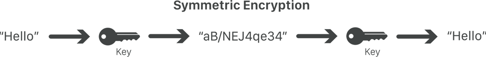
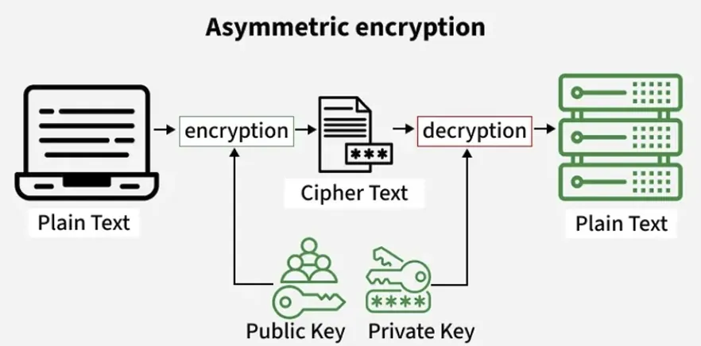
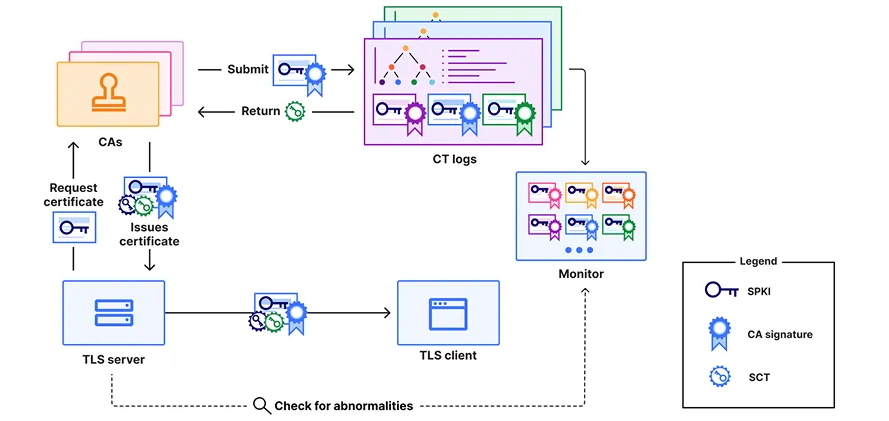
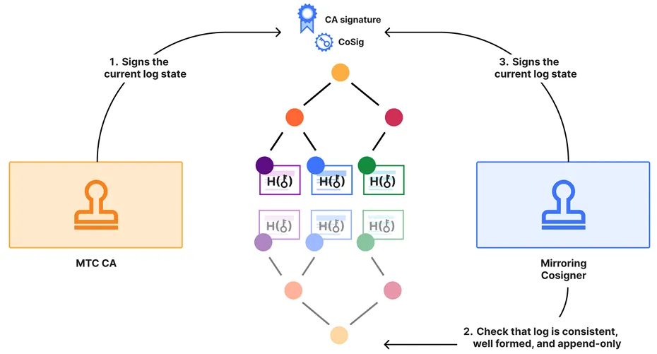
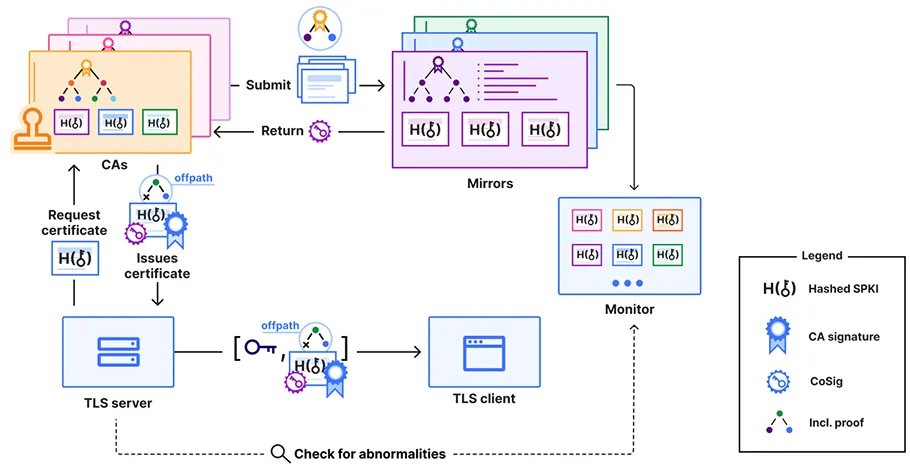
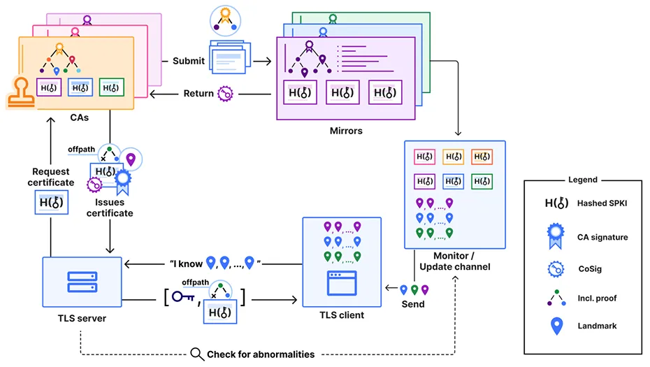

فرض کنید برای اتصال به اینترنت از یک VPN استفاده می‌کنید؛ در این حالت، تمامی ترافیک ورودی و خروجی دستگاه شما از سرور ارائه‌دهندۀ آن عبور می‌کند. حال در نظر بگیرید که می‌خواهید وارد حساب کاربری خود در یک وب‌سایت شوید.

از آن‌جا که مدیر این سرور واسط به تک‌تک بسته‌های ارسالی شما دسترسی دارد، دو پرسش مطرح می‌شود.

چگونه مطمئن می‌شوید که نام کاربری و رمز عبور شما در میانۀ مسیر شنود و سرقت نمی‌شود؟

چه تضمینی وجود دارد که سرور VPN با جعل هویت آن وب‌سایت، نسخه‌ای ساختگی از صفحه را به شما تحویل ندهد؟

برای حل این دو مشکل به دو چیز نیاز داریم و هیچ‌کدام بدون دیگری کافی نیستند.

اولی پروتکل <Tooltip tip="Transport Layer Security">TLS</Tooltip> است که ارتباط میان مرورگر و سرور مقصد را رمزگذاری می‌کند تا کسی -از جمله مدیر سرور VPN- در میانۀ مسیر، نتواند محتوای آن را بخواند یا تغییر دهد.

اما رمزگذاری به‌تنهایی کافی نیست؛ اگر مرورگر نداند طرف مقابلش کیست، ممکن است ارتباط رمزگذاری‌شده‌اش را با خود VPN برقرار کند. این‌جا دومی لازم می‌شود: «زیرساخت کلید عمومی وب» یا <Tooltip tip="Web Public Key Infrastructure">Web PKI</Tooltip>؛ مجموعه‌ای از سازمان‌ها، قواعد و پروتکل‌ها که مشخص می‌کنند کدام کلید عمومی متعلق به کدام دامنه است. مرورگر با اتکا به آن درمی‌یابد کلیدی که سرور ارائه کرده است، واقعاً متعلق به همان دامنه‌ای است که به‌دنبالش بوده است.

## رمزنگاری

[TLS](https://www.cloudflare.com/learning/ssl/how-does-ssl-work/) در دو مرحله کار می‌کند. اول، مرورگر و سرور با رمزنگاری نامتقارن به یک کلید مشترک می‌رسند و هویت سرور بررسی می‌شود؛ بعد با همان کلید و رمزنگاری متقارن، تمام داده‌ها را ردوبدل می‌کنند. از بخش متقارن شروع می‌کنیم تا ببینیم چرا نمی‌توان فقط به آن اکتفا کرد.

### رمزنگاری متقارن

در رمزنگاری متقارن یک کلید محرمانۀ مشترک هم برای رمزگذاری به کار می‌رود و هم برای رمزگشایی. بزرگ‌ترین مزیت این روش سرعت است: پردازنده‌های امروزی دستورهای سخت‌افزاری مخصوصی مثل AES-NI دارند که رمزگذاری حجم زیادی از داده را با سربار کم ممکن می‌کند.

در TLS، برای هر نشست یک کلید تازه ساخته می‌شود و پس از پایان نشست کنار گذاشته می‌شود. اما این کلید باید پیش از شروع تبادل داده نزد هر دو طرف باشد و همین‌جا مشکل شروع می‌شود: مرورگر و سرور تا آن لحظه هیچ مقدار محرمانۀ <Tooltip tip="Shared Secret">مشترکی</Tooltip> ندارند و شبکه‌ای که از آن استفاده می‌کنند، عمومی است و هر کسی می‌تواند به آن گوش دهد.

برای حل این مسئله دو راه ساده وجود دارد، ولی هیچ‌کدام امن نیستند. فرستادن مستقیم کلید فایده‌ای ندارد، چون شنودکننده هم آن را می‌بیند و می‌تواند کل ترافیک نشست را رمزگشایی کند. رمزکردن کلید با کلیدی دیگر هم مشکل را حل نمی‌کند، چون آن کلید دوم نیز باید به شکلی امن به طرف مقابل برسد و مسئله فقط یک قدم عقب می‌رود.

راه‌حل این مشکل در رمزنگاری نامتقارن است. با روشی به نام توافق کلید، دو طرف می‌توانند روی شبکۀ عمومی به یک کلید مشترک برسند، بی‌آن‌که خود کلید را بفرستند. رمزنگاری نامتقارن برای رمزکردن حجم زیاد داده بسیار کند است؛ برای همین فقط برای ساختن همین کلید به کار می‌رود و بعد از آن همۀ داده‌ها با رمزنگاری متقارن ردوبدل می‌شوند.

### رمزنگاری نامتقارن

در [رمزنگاری نامتقارن](https://www.geeksforgeeks.org/computer-networks/what-is-asymmetric-encryption/)، نه یک کلید مشترک، بلکه یک زوج‌کلید استفاده می‌شود. کلید عمومی را می‌توان بی‌خطر در اختیار همه گذاشت و کلید خصوصی باید نزد صاحبش بماند، چون از روی کلید عمومی عملاً نمی‌توان به کلید خصوصی رسید. کلید خصوصی کاربرد دیگری هم دارد؛ می‌توان با آن پیامی را «امضاء» کرد و هرکس کلید عمومی را داشته باشد، می‌تواند بررسی کند که امضا واقعاً با همان کلید خصوصی ساخته شده است. همین دو ویژگی کارهایی را ممکن می‌سازد که با رمزنگاری متقارن به‌تنهایی شدنی نیست؛ برای نمونه، دو طرفی که هیچ اطلاعات محرمانه‌ای از پیش ندارند، می‌توانند روی شبکه‌ای عمومی به یک کلید مشترک برسند و یک طرف می‌تواند هویت خود را اثبات کند.

در TLS، این سازوکار دو کار جدا انجام می‌دهد.

کار اول، توافق بر سر کلید مشترک است. مرورگر و سرور هرکدام یک زوج‌کلید <Tooltip tip="Ephemeral">موقت</Tooltip> می‌سازند. «موقت» یعنی این زوج‌کلید فقط برای همین یک ارتباط تولید می‌شود و بعد از پایانش دور ریخته می‌شود؛ برعکس کلید بلندمدت سرور که ماه‌ها و سال‌ها ثابت می‌ماند و در کار دوم مورد استفاده است. هر کدام، بخش عمومی زوج‌کلید خودش را برای طرف مقابل می‌فرستد و با ترکیب کلید خصوصی موقت خودش و کلید عمومی طرف مقابل به یک مقدار مشترک می‌رسد. کلید نشست از همین مقدار مشترک ساخته می‌شود. شنودکننده همۀ مقدارهای عمومی را می‌بیند، ولی حساب کردن مقدار مشترک از روی آن‌ها از نظر محاسباتی بسیار دشوار است.

کار دوم، احراز هویت است. توافق کلید به‌تنهایی کافی نیست. مهاجمی که وسط مسیر قرار بگیرد، می‌تواند با هر طرف جداگانه توافق کلید انجام دهد و خود را طرف دیگر معرفی کند. پس مرورگر باید مطمئن شود طرف مقابل واقعاً همان سروری است که می‌خواهد. سرور پیام‌های ردوبدل‌شده تا آن لحظه -از جمله کلید عمومی موقت خودش- را با کلید خصوصی بلندمدتش امضاء می‌کند. مهاجم کلید خصوصی سرور را ندارد، پس نمی‌تواند این امضاء را بسازد؛ و اگر کلید موقت را در مسیر عوض کرده باشد، امضاء با آن‌چه مرورگر دریافت کرده، نمی‌خواند.

مرورگر امضاء را با کلید عمومی سرور بررسی می‌کند. این کلید در یک گواهی دیجیتال است که سرور برای مرورگر می‌فرستد؛ گواهی سندی است که می‌گوید «این کلید عمومی به این دامنه تعلق دارد». آن را یک مرجع صدور گواهی یا <Tooltip tip="Certificate Authority">CA</Tooltip> معتبر امضاء کرده است و مرورگر همچنین بررسی می‌کند که گواهی منقضی نشده و برای همین دامنه صادر شده باشد. پس از پایان فرایند <Tooltip tip="Handshake">دست‌تکانی</Tooltip>، کلید موقت حذف می‌شود و تمام داده‌های نشست با کلید متقارنی که از shared secret مشتق شده است، رمزگذاری می‌شوند.

## زنجیرۀ اعتماد و مراجع صدور گواهی

مرورگر چطور تشخیص می‌دهد که گواهی ارائه‌شده از سمت سرور جعلی نیست؟ مرورگرها و سیستم‌عامل‌ها همراه خود فهرستی از مراجع صدور گواهی معتمد دارند که در «مخزن ریشه» ذخیره شده است. مرورگر به هر گواهی‌ای اعتماد می‌کند که زنجیرۀ امضاءهایش به یکی از این ریشه‌ها برسد. مرجع ریشه معمولاً به‌طور مستقیم برای وب‌سایت‌ها گواهی صادر نمی‌کند. لو رفتن کلید خصوصی ریشه کل اعتماد را از بین می‌برد، به همین دلیل آن را آفلاین و دور از دسترس نگه می‌دارند. ریشه فقط گواهی یک مرجع میانی را امضاء می‌کند و آن مرجع میانی گواهی دامنۀ مقصد را. نتیجه، یک زنجیرۀ گواهی است. سرور در دست‌تکانی گواهی خودش و گواهی‌های میانی را می‌فرستد، ولی ریشه را نمی‌فرستد؛ چون مرورگر از قبل آن را دارد. مرورگر زنجیره را از پایین به بالا بررسی می‌کند: امضای هر گواهی را با کلید عمومی گواهی بالاتر تأیید می‌کند، تاریخ اعتبار را می‌سنجد و مطمئن می‌شود زنجیره به یکی از ریشه‌های مخزن ختم می‌شود.

با این حال، اعتماد به CA به خودی خود یک ریسک است. اگر یک CA مورد نفوذ قرار گیرد یا دچار خطا شود، می‌تواند بی‌سروصدا برای هر دامنه‌ای گواهی معتبر صادر کند، بی‌آن‌که مالک دامنه متوجه شود. برای حل این مشکل، سازوکار شفافیت گواهی یا <Tooltip tip="Certificate Transparency">CT</Tooltip> به وب اضافه شد. هر گواهی باید در چند فهرست عمومی به‌عنوان لاگ ثبت شود. هر کس می‌تواند این لاگ‌ها را بخواند و مثلاً ببیند برای دامنه‌اش چه گواهی‌هایی صادر شده است. لاگ‌ها فقط‌افزودنی‌اند: فقط می‌توان ورودی تازه به آن‌ها اضافه کرد و ساختارشان طوری است که تغییر یا حذف ورودی‌های قبلی قابل‌تشخیص است.

صدور گواهی برای `sharif.edu` را در نظر بگیرید. CA نمی‌تواند ابتدا گواهی را صادر کند و سپس آن را ثبت کند، چرا که مرورگر باید از ثبت شدن آن اطمینان داشته باشد. به همین دلیل، ابتدا نسخه‌ای از گواهیِ بدون تأییدیه را با نام «پیش‌گواهی» برای چند سرور ثبت وقایع (CT Log) می‌فرستد. هر لاگ آن را ثبت می‌کند و یک برچسب زمانی امضاء‌شدۀ گواهی یا <Tooltip tip="Signed Certificate Timestamp">SCT</Tooltip> بازمی‌گرداند؛ سندی که تضمین می‌دهد این گواهی در لاگ درج خواهد شد. در نهایت، CA این SCTها را درون گواهی نهایی قرار می‌دهد و آن را به مالک دامنه تحویل می‌دهد. هنگام اتصال، مرورگر علاوه‌بر زنجیرۀ سنتی اعتبارسنجی، SCTها را هم بررسی می‌کند؛ به این صورت که باید از لاگ‌هایی باشند که خودش می‌شناسد و تعدادشان نیز کافی باشد. مرورگرهایی مثل کروم و سافاری گواهی‌ای را که SCT معتبر کافی نداشته باشد، رد می‌کنند. یعنی عملاً هر گواهی‌ای که این مرورگرها در وب عمومی بپذیرند، پیش‌تر در لاگ‌های عمومی ثبت شده است. همین ثبت اجباری است که CT را از نظر امنیتی مهم می‌کند. فرض کنید کنترل یک مرجع صدور به دست مهاجم بیفتد و او برای sharif.edu گواهی جعلی صادر کند. برای این‌که این گواهی در این مرورگرها کار کند، ناچار است آن را در لاگ‌های عمومی ثبت کند و ثبت شدنش یعنی قابل‌کشف‌شدنش: مالک دامنه و سرویس‌های پایش می‌توانند آن را ببینند و پیگیری کنند. افزون بر این، ثبت عمومی، مدرکی علیه آن CA می‌سازد که نمی‌تواند انکارش کند و می‌تواند به سلب اعتماد مرورگرها از آن منجر شود.

## تهدید کوانتومی برای رمزنگاری نامتقارن

امنیت همۀ سازوکارهای نامتقارنی که تا این‌جا دیدیم روی دو مسئلۀ ریاضی بنا شده‌اند. RSA به سختی تجزیۀ عددهای بزرگ به عوامل اول تکیه دارد و رمزنگاری خم بیضوی (که در توافق کلید ECDHE و امضای ECDSA به کار می‌رود) به‌سختی «مسئلۀ لگاریتم گسسته». برای کامپیوترهای کلاسیک، هیچ الگوریتم کارآمدی برای حل این دو شناخته نشده و شکستن‌شان زمان و منابعی نجومی می‌طلبد. کامپیوتر کوانتومی این وضع را عوض می‌کند. الگوریتم <Tooltip tip="Shor’s Algorithm">شور</Tooltip> هر دو مسئله را در زمانی معقول حل می‌کند؛ یعنی از روی کلید عمومی می‌توان کلید خصوصی را محاسبه کرد. البته شور فقط روی کامپیوتر کوانتومی مقاوم در برابر خطا با تعداد کافی کیوبیت منطقی اجرا می‌شود (کیوبیت منطقی از ترکیب تعداد زیادی کیوبیت فیزیکی پرخطا ساخته می‌شود). شکسته شدن این دو مسئلۀ ریاضی، هر دو پایه‌ای را که در ابتدا برای امنیت برشمردیم متزلزل می‌کند. نخست، محرمانگی ارتباط، یعنی همان پرسش اول: مهاجم نیازی ندارد رمزگشایی را در همان لحظه انجام دهد؛ کافی است ترافیک رمزگذاری‌شدۀ شما را امروز ذخیره کند. سال‌ها بعد، با در دست داشتن یک کامپیوتر کوانتومی می‌تواند کلید موقت هر نشست را از روی همان مقدارهای عمومی ردوبدل‌شده بازسازی کند و تمام ترافیک گذشته را بخواند. در این‌جا موقت‌بودن کلیدها کمکی نمی‌کند، چون تمام داده‌های لازم برای محاسبۀ دوبارۀ آن‌ها از همان ابتدا آشکارا روی شبکه مخابره شده است. دوم، احراز هویت، یعنی همان پرسش دوم: اگر مهاجم بتواند از روی کلید عمومی یک CA به کلید خصوصی آن برسد، می‌تواند برای هر دامنه‌ای گواهی‌ای بسازد که مرورگر آن را معتبر بداند. در این وضعیت، Web PKI و زنجیرۀ اعتمادی که برای شناسایی سرور ساخته بودیم بی‌معنا می‌شود و دیگر هیچ تضمینی نیست که طرف مقابل، نسخه‌ای ساختگی از وب‌سایت را پیش روی شما نگذاشته باشد.

## بحران مقیاس‌پذیری

دو الگوریتم پساکوانتومی پس از سال‌ها بررسی عمومی، استاندارد شده‌اند؛ ML-KEM برای توافق کلید و ML-DSA برای امضاء. تا کنون هیچ الگوریتم کوانتومی شناخته‌شده‌ای برای شکستن آن‌ها ارائه نشده است. توافق کلید همین حالا در حال رفتن به ML-KEM است، چون خطر محرمانگی فوری است. Cloudflare می‌گوید بخش بزرگی از ترافیکش همین حالا از ترکیب الگوریتم قدیمی و جدید استفاده می‌کند.

پس مشکل اصلی که می‌ماند احراز هویت است و علتش اندازۀ امضاء‌هاست. طول امضاء ML-DSA-44 برابر با ۲۴۲۰ بایت و امضاء ECDSA فقط ۶۴ بایت است؛ یعنی افزایشی نزدیک به ۳۸ برابر. کلید عمومی نیز از ۶۴ بایت به ۱۳۱۲ بایت می‌رسد. در هر اتصال، چندین امضاء و کلید عمومی مبادله می‌شود (امضاء سرور، امضاء‌های زنجیره و SCTها). اگر همگی با ML-DSA جایگزین شوند، حجم آن‌ها از حدود ۴ کیلوبایت به حدود ۱۵ کیلوبایت می‌رسد.

این موضوع از نظر عملکرد شبکه تعیین‌کننده است؛ اگر حجم از سقف پنجرۀ اولیۀ ارسال در TCP (حدود ۱۴٫۶ کیلوبایت) فراتر برود، یک زمان رفت‌وبرگشت یا <Tooltip tip="Round-Trip Time">RTT</Tooltip> اضافه به اتصال تحمیل می‌شود و صفحه دیرتر باز خواهد شد. افزون بر این، لاگ‌های CT نیز موظف به ذخیرۀ این امضاها هستند و طبق برآوردهای Cloudflare، حجم ذخیره‌سازی آن‌ها حدود ۴۰ برابر خواهد شد.

## گواهی‌های درخت مرکل یا <Tooltip tip="Merkle Tree Certificates">MTC</Tooltip>

در معماری فعلی، صدور و ثبت دو کار جداگانه‌اند و هر کدام امضاء خودش را می‌خواهد. CA گواهی را امضاء می‌کند، لاگ‌ها برای آن <Tooltip tip="Signed Certificate Timestamp">SCT</Tooltip> صادر می‌کنند و همین گواهی در دو شکل (پیش‌گواهی و گواهی نهایی) در چند لاگ تکرار می‌شود. دو هزینه‌ای که در بخش قبل دیدیم، یعنی امضاء‌های سنگین در دست‌تکانی و حجم لاگ‌ها، از همین تکرار می‌آید.

ایدۀ «[گواهی‌های درخت مرکل](https://blog.cloudflare.com/pq-ca-with-mtcs/)» این تفکیک را از میان برمی‌دارد و رویکرد صدور از طریق ثبت در لاگ را دنبال می‌کند؛ به‌گونه‌ای که گواهی تنها زمانی صادرشده تلقی می‌شود که در لاگ به ثبت رسیده باشد. در این الگو، ثبت دیگر مرحله‌ای مجزا پس از صدور نیست، بلکه شفافیت به بخشی ذاتی از خود سازوکار صدور تبدیل می‌شود. در عمل، CA لاگ خودش را نگه می‌دارد و این لاگ یک درخت مرکل فقط‌افزودنی است. وقتی درخواست صدور می‌رسد (معمولاً از طریق پروتکل ACME)، مرجع صدور گواهی کنترل متقاضی بر دامنه را راستی‌آزمایی می‌کند و ورودی جدید را -شامل نام دامنه و کلید عمومی- به انتهای لاگ اضافه می‌کند. بعد تک‌تک گواهی‌ها را امضاء نمی‌کند و فقط وضعیت کل درخت را در قالب یک checkpoint یا tree head امضاء می‌کند. این امضاء تأیید می‌کند که CA همۀ ورودی‌های درخت تا آن لحظه را صادر کرده است. گواهی دیگر امضاء مستقلی ندارد و در عوض، اثبات این‌که در درخت هست همراهش می‌آید.

درخت مرکل یک درخت هش است. هر ورودی یک برگ است، هر گره والد هش پیوند دو فرزندش است و ریشه، چکیدۀ رمزنگاری‌شدۀ کل درخت است. برای اثبات این‌که یک ورودی در درخت هست، لازم نیست کل درخت فرستاده شود. کافی است هش گره برادر هر گره در مسیر برگ تا ریشه را بفرستیم، که به آن اثبات عضویت می‌گویند. گیرنده با ترکیب پله‌به‌پلۀ این هش‌ها ریشه را بازسازی می‌کند و اگر با ریشۀ امضاء‌شده یکی بود، عضویت ثابت می‌شود. در درختی با ۸ برگ، اثبات عضویت فقط ۳ هش دارد. اندازۀ اثبات با لگاریتم تعداد برگ‌ها رشد می‌کند، پس حتی برای یک میلیون گواهی حدود ۲۰ هش کافی است؛ یعنی با هش ۳۲ بایتی، اثبات حدود ۶۴۰ بایت و کمتر از ۱ کیلوبایت می‌شود. به همین دلیل، یک امضاء می‌تواند تعداد بسیار زیادی گواهی را پوشش دهد.

لاگ صدور CA، مرجع انحصاری تمامی گواهی‌های آن CA به‌شمار می‌رود؛ بنابراین، هر گواهی تنها یک‌بار ذخیره می‌شود و پایش‌گرها نیز تنها کافی است همین یک لاگ را بررسی کنند. علاوه‌بر این، ورودی‌ها امضاء مجزا ندارند و تنها یک امضاء بر فراز رأس درخت، کل لاگ را پوشش می‌دهد؛ لاگ هم نه خود کلیدها، بلکه صرفاً هش کلیدهای عمومی را نگه می‌دارد. این موارد دقیقاً همان عواملی هستند که در سازوکار فعلی CT، با ورود امضاء‌های پساکوانتومی حجم ذخیره‌سازی را تا ۴۰ برابر افزایش می‌دادند.

اگر فقط خود CA لاگ را امضا کند، هنوز می‌تواند به طرف‌های مختلف، نسخه‌های متفاوتی از لاگ نشان دهد. برای همین، وضعیت لاگ به یک co-signer مستقل هم فرستاده می‌شود. این co-signer یک نسخه از لاگ را نگه می‌دارد، بررسی می‌کند که هر وضعیت جدید با وضعیت قبلی سازگار و فقط‌افزودنی باشد و آن را هم امضاء می‌کند. پیش‌نویس سیاست کروم دست‌کم دو co-signature می‌خواهد: یکی از یک Mirroring Co-signer با سازمانی غیر از CA و یکی از خود CA. نتیجه این است که گواهی‌ها حتی اگر لاگ خود CA از دسترس خارج شود، برای پایش در دسترس می‌مانند.

## حالت <Tooltip tip="Landmark">لندمارک</Tooltip>: حذف امضاء CA از شبکه

گواهی درخت مرکل دو حالت دارد.

- **حالت مستقل:** سرور اثبات عضویت را همراه با امضاء پساکوانتومی ریشۀ درخت ارسال می‌کند. این حالت مختص کلاینت‌هایی است که داده‌های لندمارک به‌روز در اختیار ندارند.
- **حالت لندمارک:** به‌صورت دوره‌ای یک ریشه به‌عنوان «لندمارک» (نشانۀ مرجع) انتخاب می‌شود و هش آن از طریق به‌روزرسانی‌های مرورگر به کلاینت‌ها می‌رسد. هنگام اتصال، سرور فقط گواهی و اثبات عضویت را می‌فرستد. مرورگر ریشه را از روی اثبات بازسازی می‌کند و با هش لندمارکی که از پیش دارد، تطبیق می‌دهد. بدین ترتیب، خود گواهی هیچ امضایی ندارد و امضاء CA و تأییدیه‌های CT از شبکه حذف می‌شوند. فقط امضاء دست‌تکانی سرور می‌ماند، چون اثبات عضویت نشان می‌دهد گواهی در درخت هست، نه این‌که فرستنده کلید خصوصی را دارد. با ML-DSA-44، این یعنی حدود ۳۷۰۰ بایت (کلید عمومی سرور و همین امضاء)، که تقریباً هم‌اندازۀ زنجیرۀ کلاسیک امروز است.

در [آزمایش مشترک Cloudflare و کروم](https://blog.cloudflare.com/bootstrap-mtc/)، میانۀ زمان دست‌تکانی با حالت لندمارک حدود ۹ درصد کم‌تر از زنجیره‌های کلاسیک بود.

## چالش‌ها و چشم‌انداز پیاده‌سازی

اثربخشی حالت لندمارک کاملاً به دسترسی کلاینت به داده‌های به‌روز وابسته است. ابزارهای خط فرمان نظیر curl، اسکریپت‌های خودکار و سامانه‌های اینترنت اشیاء، فاقد چرخۀ به‌روزرسانی پیوسته، مشابه مرورگرها هستند؛ از این رو، سرورها همچنان باید برای کلاینت‌هایی که داده‌های لندمارک به‌روز ندارند یا از MTC پشتیبانی نمی‌کنند، گواهی کلاسیک پشتیبان نگه دارند.

چالش دوم، مسئلۀ پذیرش و هم‌گرایی در اکوسیستم وب است. MTC در حال حاضر در سطح پیش‌نویس اینترنتی IETF قرار دارد و هنوز به استاندارد رسمی (RFC) تبدیل نشده است. شرکت گوگل اعلام کرده برنامه‌ای برای افزودن گواهی‌های سنتی مبتنی‌بر الگوریتم‌های پساکوانتومی به مخزن ریشۀ فعلی کروم ندارد و مخزن ریشۀ مجزایی را برای MTC پیاده‌سازی می‌کند؛ ضوابط نهایی ورود مراجع صدور به این مخزن برای سه‌ماهۀ سوم ۲۰۲۷ زمان‌بندی شده است. Cloudflare نیز متقاضی ورود به این سازوکار است، هرچند تا کنون صدور عملیاتی را آغاز نکرده است. در نهایت، هم‌سویی شرکت‌های اپل، مایکروسافت و موزیلا تعیین خواهد کرد که آیا MTC به استانداردی فراگیر در پهنۀ اینترنت بدل خواهد شد یا تنها در حد بهینه‌سازی اختصاصی در اکوسیستم کروم باقی خواهد ماند.
