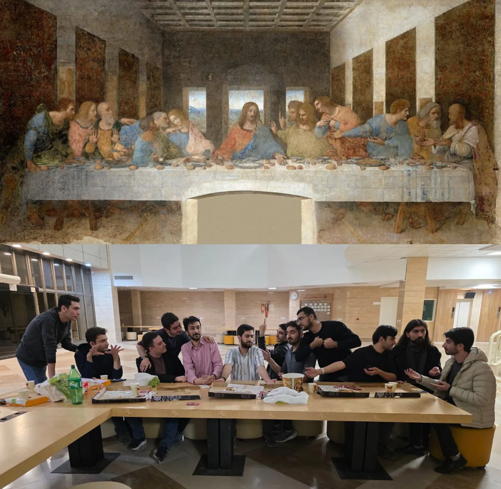

حدود یک سال پیش بود که یکی از دوستان سال‌بالایی‌ام، بایت را به من معرفی کرد و از شکل‌گیری بخش جدیدی در نشریه گفت؛ مجموعه‌ای که برای آغاز فعالیتش به‌دنبال اعضای تازه‌ای بود. آن روز شاید تصور نمی‌کردم پیوستن به این جمع، به یکی از تجربه‌های مهم دوران دانشجویی‌ام تبدیل شود. شناخت چندانی از فضای نشریه نداشتم و تصویر روشنی از مسیر پیش رویمان برایم شکل نگرفته بود. با این‌حال، پیشنهاد همکاری را پذیرفتم و به جمعی پیوستم که قرار بود سالی پرفرازونشیب را در کنار یک‌دیگر پشت سر بگذاریم.

سال گذشته، سال آسانی نبود؛ نه برای کشور و نه برای بایت. اعتراضات خونین، سایۀ جنگ و در نهایت وقوع آن، روزهایی دشوار را رقم زدند. دانشگاه نیز برای نزدیک به ۹ ماه، از ۹ دی سال گذشته تا اول مهر امسال، تعطیل بود. با این‌حال، بایت در این روزها برخلاف باقی نشریات و کانون‌های فرهنگی، متوقف نشد. امیرحسین شهیدی، مدیرمسئول وقت نشریه، در شرایطی دشوار امور بیرونی را پیش برد و یکی از سخت‌ترین شماره‌های تاریخ دانشگاه را به چاپ رساند. آرش شاه‌حسینی، سردبیر وقت، نیز در دوران تعطیلی دانشگاه ارتباط اعضا را حفظ کرد و توانست در فرصتی یک‌هفته‌ای، دوباره جمع را کنار هم بیاورد و شماره‌ای تازه را آمادۀ انتشار کند.

در میانۀ اعتراضات و روزهایی که فضای کشور ملتهب بود، تصمیم گرفتم متنی برای بایت بنویسم. راستش انتظار نداشتم پیشنهادم چندان جدی گرفته شود؛ اما با استقبال امیرحسین روبه‌رو شدم و وقتی موضوع را با آرش مطرح کردیم، او هم با اشتیاق همراه شد.

همین اتفاق ساده باعث شد نگاهم به حضورم در بایت تغییر کند. آن شب، با استرس فراوان اما قلب‌هایی مطمئن، کنار هم نشستیم و سرمقاله‌ای نوشتیم. همان شب بود که «شام آخر» شکل گرفت؛ شامی که واقعاً شام آخر شد!

شاید این خاطره در نگاه اول، اتفاق کوچکی در میان تمام آن روزهای دشوار به نظر برسد؛ اما برای من، تصویری از چیزی است که بایت را ساخته است: فضایی که در آن ایده‌ها فرصت مطرح شدن پیدا می‌کنند، اعضا می‌توانند فراتر از مسئولیت اولیه‌شان نقش بگیرند و اعتماد، زمینه‌ساز مشارکت و همراهی می‌شود. آن‌چه بایت را بایت کرده، صرفاً انتشار چند شماره نیست؛ آدم‌هایی‌اند که در روزهای آسان و دشوار، تصمیم گرفته‌اند کنار یک‌دیگر بمانند و چیزی را با هم بسازند.

شاید در اولین سرمقاله به‌عنوان سردبیر باید از موجی تازه، ایده‌هایی نو و مسیری متفاوت حرف بزنم. اما نه! پیش از هر چیز، باید به یاد داشته باشیم که این مسیر از پیش آغاز شده است. آرش و امیرحسین، در کنار دیگر اعضای نشریه، بخشی از راه را ساخته‌اند و آن‌چه امروز در اختیار ماست، حاصل تلاش و تجربۀ جمعی آن‌هاست. تغییر مسئولیت‌ها به‌معنای شروع از نقطۀ صفر نیست؛ هر شماره، هر ایده و حتی هر تجربۀ ناموفق، بخشی از مسیری است که بایت تا امروز پیموده است. بایت قرار است نشریۀ همۀ دانشجویان دانشکدۀ مهندسی کامپیوتر شریف باشد؛ جمعی که در آن تفاوت سلیقه‌ها و دغدغه‌ها نه مانع، بلکه فرصتی برای بهتر دیدن و بهتر ساختن است. امیدوارم در فصل تازۀ فعالیت نشریه، صداهای بیشتری شنیده شوند و دانشجویان بیشتری فرصت پیدا کنند تا ایده‌ها و نگاهشان را با دیگران به اشتراک بگذارند. این مسیر، بی‌تردید دشواری‌های خودش را خواهد داشت؛ اما آن‌چه می‌تواند بایت را زنده و پویا نگه دارد، حضور آدم‌هایی است که برای ساختنش وقت می‌گذارند.

پس به احترام تمام کسانی که تا امروز برای بایت نوشتند، ساختند و ماندند؛ آنان که بخشی از وقت و وجود خود را در این نشریه گذاشتند و از ادامه دادن نهراسیدند؛ و به امید تمام کسانی که قرار است از این پس عضوی از این خانواده شوند:

**۳، ۲، ۱؛ ادامۀ حرکت!**

